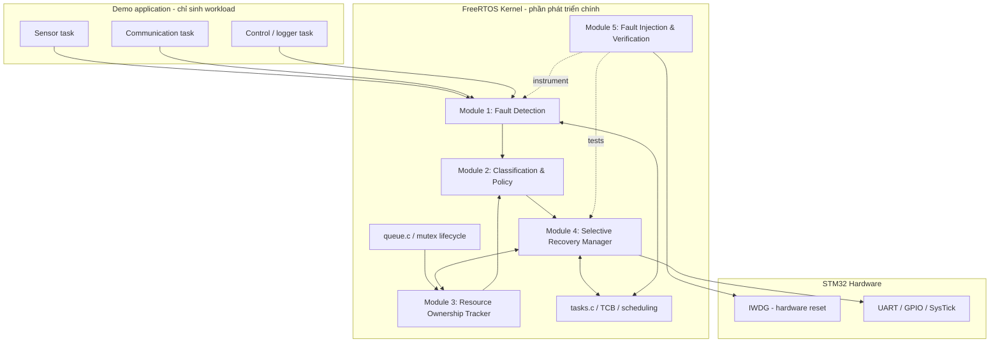
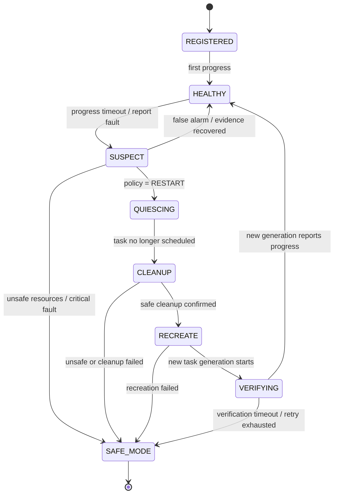

# ĐẶC TẢ ĐỀ TÀI BÀI TẬP LỚN HỆ ĐIỀU HÀNH

> **Tên tiếng Việt:** Thiết kế và triển khai cơ chế phát hiện và phục hồi có chọn lọc lỗi tác vụ, có xét trạng thái tài nguyên, ở mức kernel FreeRTOS trên STM32  
> **Tên tiếng Anh:** Design and Implementation of a Resource-Aware Selective Task Fault Recovery Framework for FreeRTOS on STM32  
> **Tên ngắn:** RTSFR (*Resource-aware Task Selective Fault Recovery*)  
> **Phiên bản đặc tả:** 1.0 — 04/11/2026  
> **Đối tượng:** Bài tập lớn Hệ điều hành, nhóm 5 thành viên  
> **Trạng thái:** Đặc tả thiết kế/triển khai; **chưa phải kết quả thí nghiệm đã hoàn thành**.

---

## 0. Tóm tắt cho giảng viên

### 0.1. Vấn đề

Trong một hệ thống nhúng chạy FreeRTOS, một tác vụ có thể ngừng tiến triển do vòng lặp vô hạn, lỗi điều khiển luồng, không còn gửi tín hiệu tiến độ, hoặc bị kẹt ở một bước xử lý không mong đợi. Reset toàn bộ vi điều khiển để xử lý lỗi một task làm gián đoạn cả những task đang hoạt động tốt. Tuy nhiên, xóa rồi tạo lại task một cách máy móc cũng có thể để lại mutex, bộ nhớ và trạng thái dùng chung không nhất quán.

**Câu hỏi nghiên cứu:** Có thể phát hiện task không tiến triển và chỉ phục hồi những task có trạng thái tài nguyên đủ an toàn, trong khi vẫn giữ các task khỏe mạnh hoạt động, với chi phí RAM/CPU chấp nhận được trên STM32F103 hay không?

### 0.2. Giải pháp

Mở rộng FreeRTOS kernel bằng hệ thống RTSFR gồm năm module:

1. **Fault Detection & Kernel Integration** — theo dõi tiến độ và trạng thái task từ kernel.
2. **Fault Classification & Recovery Policy** — đánh giá điều kiện, mức nguy hiểm và lựa chọn hành động.
3. **Resource Ownership Tracker** — ghi nhận tài nguyên được kernel quản lý mà task đang sở hữu.
4. **Selective Recovery Manager** — cô lập thực thi, dọn dẹp khi an toàn, khởi tạo lại task và kiểm tra sau phục hồi.
5. **Fault Injection, Verification & Watchdog** — tạo lỗi có kiểm soát, kiểm chứng bất biến, đo đạc và reset dự phòng bằng IWDG.

**Đóng góp cốt lõi:** Quyết định restart dựa trên trạng thái tài nguyên, không chỉ timeout/heartbeat. Có **nghĩa vụ chứng minh an toàn trước khi thu hồi**; nếu không chứng minh được, chuyển **SAFE_MODE** hoặc yêu cầu reset, không cố restart bằng mọi giá.

### 0.3. Kết quả bàn giao tối thiểu

- Mã nguồn FreeRTOS gốc (V0), phiên bản giám sát/restart cơ bản (V1), phiên bản resource-aware (V2), giữ được diff rõ ràng.
- Một firmware STM32 có các task demo; lỗi giả lập tái hiện được; có log rõ trình tự phát hiện → phân loại → quyết định → phục hồi / safe mode.
- Cơ chế kernel-level có thay đổi thật trong vòng đời task / quản lý tài nguyên, không chỉ application gọi `vTaskDelete()` và `xTaskCreate()`.
- Bộ test PASS/FAIL, kết quả định lượng, báo cáo overhead và giới hạn hệ thống.

---

## 1. Môi trường và ràng buộc

| Hạng mục | Quyết định thiết kế |
|---|---|
| Phần cứng chính | STM32F103C8T6 (Blue Pill), Cortex-M3, 72 MHz, **64 KB Flash / 20 KB SRAM theo định danh chính thức** |
| Hệ điều hành | FreeRTOS-Kernel; **khóa ở một tag + commit cụ thể**; gợi ý bắt đầu V11.3.1 nếu toolchain hỗ trợ ổn định |
| IDE/build | STM32CubeMX cấu hình ngoại vi, **Keil µVision5/MDK-ARM** build/flash/debug; không bắt buộc CubeIDE |
| Port | Chọn đúng port Cortex-M3 theo compiler (ví dụ `portable/RVDS/ARM_CM3/` đối với cấu hình Arm Compiler tương thích, hoặc `portable/GCC/ARM_CM3/` với GCC); kiểm tra toolchain thực tế |
| Kết nối | ST-LINK và UART → USB-UART để log; LED GPIO cho demo |
| Watchdog | Independent Watchdog (IWDG) của STM32; thời gian thực tế chịu sai số LSI |
| Ngôn ngữ | C cho firmware/kernel; script Python tùy chọn để lưu log và tổng hợp số liệu |
| Số task | 3 task demo + kernel-owned supervisor/recovery task (có thể gộp) + idle task; giới hạn bộ nhớ trên bo |
| Phạm vi | Một lõi CPU, FreeRTOS không MPU, cấu hình không có memory isolation cứng tin cậy |

> **Lưu ý về board:** Một số Blue Pill trên thị trường có phần cứng/nhận dạng không chuẩn; phải kiểm tra flash thực, linker map, nguồn clock và kết quả debug. Không thiết kế dựa trên giả định có thêm Flash/RAM chưa xác nhận.

### 1.1. Mức sửa kernel để đáp ứng yêu cầu môn học

Phải có **mã nguồn và/hoặc cấu trúc dữ liệu nội bộ thuộc kernel** được sửa hoặc bổ sung thực chất:

- `tasks.c` / cơ chế vòng đời task: móc nối đăng ký/xóa task, ổn định trạng thái và điểm chuyển sang recovery.
- `queue.c` / quản lý mutex: móc nối **sau khi take/give thành công** để đồng bộ resource ownership trong đường đi kernel; không coi wrapper app là giải pháp chính.
- Các file mới trong **nhánh kernel do nhóm kiểm soát**: `rtsfr_detect.c`, `rtsfr_policy.c`, `rtsfr_resource.c`, `rtsfr_recovery.c`, `rtsfr_verify.c`, `rtsfr_internal.h`.
- `portable/*` và HAL chỉ sửa khi có yêu cầu kỹ thuật rõ, tuyệt đối không cần viết lại scheduler, PendSV hoặc port assembly để chứng minh làm kernel.

**Không đủ:** Viết supervisory task tầng application gọi API FreeRTOS, không đụng cơ chế dữ liệu/vòng đời task của kernel.

### 1.2. Giới hạn cam kết an toàn

- **Không có cách ly bộ nhớ cứng / MPU dựa vào trong baseline**: một task ghi sai con trỏ vẫn có thể phá hỏng kernel; tránh khẳng định phục hồi được memory corruption.
- Không phục hồi tự động một HardFault/stack overflow tùy ý; các lỗi này được xem là **untrusted state** trừ khi có lập luận cụ thể khác.
- Không tự động `give` mutex bị task lỗi giữ, vì protected shared data có thể dang dở.
- Không giả định task ở trạng thái `Blocked` là lỗi: `vTaskDelay()` hoặc chờ queue/mutex có thể là bình thường.
- Nếu scheduler/tick/interrupt/critical section bị kẹt khiến supervisor không chạy được, **IWDG là lớp fallback**, không phải selective recovery.
- Không đặt mục tiêu chứng minh hệ thống đạt tiêu chuẩn an toàn chức năng; chỉ là nguyên mẫu học thuật có giới hạn fault model xác định.

---

## 2. Phạm vi lỗi hỗ trợ

### 2.1. Ma trận hỗ trợ

| Fault ID | Tình huống | Cách phát hiện | Quyết định phiên bản V2 |
|---|---|---|---|
| F01 | Task không report tiến độ trong cửa sổ cho phép, scheduler còn chạy | Progress timeout | Restart khi `resources_safe = true` |
| F02 | Task vòng lặp vô hạn nhưng còn cho tick/supervisor chạy | Progress timeout | Restart nếu task không giữ tài nguyên nguy hiểm |
| F03 | Task phát hiện lỗi nội bộ và báo tự nguyện | Fault report | Restart / safe mode theo policy |
| F04 | Task block/delay hợp lệ | Expected-wait contract | **Không kết luận là lỗi** |
| F05 | Task lỗi khi đang giữ **managed buffer độc quyền** không còn truy cập ngoài | Resource snapshot | Cleanup buffer → restart nếu chứng minh an toàn |
| F06 | Task lỗi khi đang giữ FreeRTOS mutex | Mutex ownership snapshot | **SAFE_MODE** mặc định; không tự release |
| F07 | Task liên tục lỗi sau nhiều lần restart | Retry window/budget | SAFE_MODE hoặc reset theo mức criticality |
| F08 | Kernel stop, ngắt/tick không còn hoạt động, CPU kẹt trong critical section | IWDG timeout | Hardware reset |
| F09 | Stack overflow, HardFault, ghi hỏng TCB hoặc con trỏ kernel | Hook / exception / kiểm tra phụ | Log tối thiểu nếu còn tin cậy; **reset**, không hứa restart an toàn |
| F10 | Chờ mutex quá lâu nhưng còn nằm trong thời hạn chờ hợp lệ | State + expected wait | Không restart khi chưa xác định lỗi |

**Quan trọng:** F01–F03 là *dấu hiệu lỗi thuộc mô hình hỗ trợ*, không chứng minh task đã hỏng. Chính sách phải hạn chế false positives.

### 2.2. Hai lớp “cô lập” phải phân biệt

1. **Execution isolation (hỗ trợ):** Ngừng lên lịch task lỗi qua suspend/delete trong điều kiện scheduler còn tin cậy.
2. **Memory isolation (không được cam kết):** Ngăn task truy cập mọi vùng RAM khác. STM32F103 + thiết kế này **không cung cấp** bảo đảm đó.

### 2.3. Mức hoàn thành

- **MVP / bắt buộc:** F01, F03, F04, F07, F08; F02 trong trường hợp supervisor vẫn chạy; restart task không giữ resource.
- **Bản đầy đủ:** F05 với managed buffer, F06 với policy safe mode và resource metadata; lifecycle hooks; đo overhead.
- **Mở rộng nếu còn thời gian:** timeout phân biệt theo expected block, N lần restart theo sliding window, fault coalescing, log sau reset, nhiều task phụ thuộc.

---

## 3. Kiến trúc tổng thể



### 3.1. Tách hai đường điều khiển

**Fast path:** Các hook tại `tasks.c`, `queue.c` cập nhật metadata ngắn, bounded, không cấp phát động, không in UART, không gọi API gây block.

**Control path:** Một **kernel-owned supervisor task** đọc sự kiện, phân loại và thực hiện chuỗi recovery có thể tốn thời gian; do đó không thực hiện toàn bộ recovery trong tick ISR/critical section.

### 3.2. Vị trí supervisor

- Tạo một task nội bộ (`RTSFR_Supervisor`) từ quá trình khởi tạo được kiểm soát bởi kernel extension.
- Priority supervisor cao hơn những task *được giám sát*, nhưng không dùng vòng lặp bận; thức dậy theo notify/chu kỳ.
- Chỉ đọc/ghi bảng theo atomic/critical section rất ngắn; không được giữ mutex application để điều hành recovery.
- Không thể cứu hệ thống nếu interrupt bị tắt vĩnh viễn hoặc vùng nhớ kernel bị phá hỏng.

### 3.3. Phân lớp

| Lớp | Chứa gì | Ai chịu trách nhiệm |
|---|---|---|
| Application demo | Sensor/Comm/Control, cập nhật `rtsfr_report_progress()` và fault injection commands | Module 1 + Module 5 phối hợp |
| Kernel monitoring/policy | Task record, event, timeout, policy | Module 1 + 2 |
| Kernel resource/lifecycle | Managed buffer, mutex ownership hooks, delete/create coordination | Module 3 + 4 |
| Hardware recovery | IWDG và reset-cause inspection | Module 5 |
| Measurement | Trace ring buffer, counters, output CSV | Module 5; mọi module cung cấp event |

---

## 4. Trạng thái hệ thống, task và luồng xử lý

### 4.1. Trạng thái của một task được giám sát



> `QUIESCING` nghĩa là ngừng lên lịch **khi scheduler vẫn còn hoạt động**, không phải dừng tại mọi instruction một cách an toàn tuyệt đối. `SAFE_MODE` giữ thiết bị ở trạng thái đầu ra an toàn theo demo; có thể vẫn chạy các task giám sát.

### 4.2. Luồng lỗi F01 — task không tiến triển, không giữ tài nguyên

1. Task đăng ký health contract và tăng `progress_counter` tại mốc công việc **thực sự hoàn tất**.
2. Monitor theo chu kỳ lấy thời điểm tiến độ cuối, phân biệt task đang chờ hợp lệ.
3. Khi quá `timeout_ticks`, ghi `FAULT_NO_PROGRESS` và generation hiện tại.
4. Policy kiểm tra mức criticality, retry budget, resource snapshot.
5. Nếu kết quả policy sơ bộ cho phép thử recovery, Recovery Manager đưa task khỏi lịch thực thi (quiesce) rồi **kiểm tra lại resource snapshot và generation sau khi task đã ngừng chạy**. Nếu unsafe/unknown ⇒ SAFE_MODE, không cleanup/restart.
6. Đảm bảo hoàn tất phần xóa task và cleanup kernel theo cơ chế/version FreeRTOS đang dùng; **không tái dùng TCB/stack khi còn tham chiếu**.
7. Tạo task instance mới từ descriptor bất biến; gán `generation++`, khởi tạo dữ liệu trạng thái mới.
8. Đợi lần report tiến độ đầu tiên trong `verify_timeout_ticks`; thành công → HEALTHY, thất bại → retry/safe mode.
9. Log đầy đủ fault → action → result, đo recovery latency.

### 4.3. Luồng lỗi F06 — task đang giữ mutex

1. Monitor phát hiện task không tiến triển.
2. Tracker cho biết task đang sở hữu ít nhất một mutex.
3. Policy **từ chối auto-release/restart** vì vùng dữ liệu được mutex bảo vệ có thể đang chỉnh sửa dở.
4. Chuyển SAFE_MODE (ví dụ ngừng cập nhật output điều khiển, báo lỗi LED), tiếp tục nuôi IWDG **chỉ nếu trạng thái safe-mode thật sự hợp lệ**, hoặc để IWDG reset theo policy.
5. Log `BLOCKED_BY_UNSAFE_RESOURCE` để minh chứng nhóm không phục hồi thiếu an toàn.

### 4.4. Luồng lỗi F05 — task giữ buffer đã đăng ký, có thể thu hồi

1. Tracker xác nhận buffer thuộc task lỗi, không có consumer khác, DMA hoặc peripheral còn tham chiếu.
2. Recovery Manager ngừng task, gọi thao tác cleanup **nội bộ đã được kiểm định** trên buffer đó.
3. Tracker cập nhật ownership; invariant `one_owner_or_free` phải đúng.
4. Chỉ restart khi **mọi** resource đã được phân loại `RECLAIMED` hoặc `SAFE`.
5. Nếu bất kỳ resource `UNKNOWN`/`SHARED_IN_FLIGHT` → quarantine + SAFE_MODE, không trả buffer vào pool.

### 4.5. Luồng F08 — kernel không còn vận hành

- Nếu scheduler/tick không gọi được supervisor, phần mềm không thể tin cậy để tự sửa; IWDG hết hạn → reset MCU.
- Sau reset: đọc reset cause (ví dụ IWDG), lưu/thống kê số lần reset nếu có nơi lưu trạng thái bền vững phù hợp. Không ghi flash liên tục gây hao mòn.

---

## 5. Mô hình dữ liệu và các hợp đồng chung

### 5.1. Task descriptor do kernel quản lý

Mỗi task được giám sát có **task_id ổn định**; `TaskHandle_t` chỉ hợp lệ cho **một generation** và phải được thay khi restart.

| Trường | Kiểu gợi ý | Ý nghĩa |
|---|---|---|
| `task_id` | `uint8_t` | ID ổn định, 1..`MAX_MONITORED_TASKS` |
| `generation` | `uint16_t` | Tăng sau mỗi lần tạo mới; chống nhầm handle cũ |
| `handle` | `TaskHandle_t` | Handle instance hiện tại (có thể đổi) |
| `entry` | `TaskFunction_t` | Entry function được phép khởi tạo lại |
| `arg` | `void *` | Context tĩnh/được quản lý, hợp lệ sau restart |
| `stack_depth` | `configSTACK_DEPTH_TYPE` hoặc kiểu đúng của kernel được khóa | Stack size **theo đơn vị FreeRTOS quy định, không mặc định là byte** |
| `priority` | `UBaseType_t` | Base priority của task |
| `criticality` | `LOW/MEDIUM/HIGH` | Policy action khi lỗi |
| `progress_timeout_ticks` | `TickType_t` | Cửa sổ không tiến triển |
| `last_progress_tick` | `TickType_t` | Thời điểm tiến độ gần nhất |
| `progress_counter` | `uint32_t` | Tăng khi công việc thực hoàn thành |
| `expected_wait_until` | `TickType_t` + flag | Cho phép block có kế hoạch, không báo nhầm |
| `retry_count/window_start` | số nguyên, tick | Giới hạn restart |
| `state` | `rtsfr_task_state_t` | HEALTHY / SUSPECT / ... |

Giới hạn mảng cố định, ví dụ `MAX_MONITORED_TASKS = 3` hoặc 4; **không** dùng bảng không giới hạn hoặc cấp phát trong hook.

### 5.2. Fault event (giao thức M1 → M2)

```c
typedef struct {
    uint8_t       task_id;
    uint16_t      generation;
    uint32_t      event_id;
    TickType_t    observed_tick;
    rtsfr_fault_t fault_type;
    uint32_t      evidence; /* e.g. elapsed ticks / progress counter */
} rtsfr_fault_event_t;
```

**Hợp đồng:** Generation của event phải khớp instance hiện tại; event trùng `event_id` không được khởi động hai luồng recovery. Chỉ mang dữ liệu nhỏ, không dùng con trỏ sang stack của task sắp bị xóa.

### 5.3. Resource summary (M3 → M2/M4)

```c
typedef struct {
    uint8_t task_id;
    uint16_t generation;
    uint8_t mutex_held_count;
    uint8_t managed_buffers_owned;
    uint8_t unknown_resource_count;
    bool    has_inflight_io;
    bool    can_reclaim_all;
} rtsfr_resource_summary_t;
```

`can_reclaim_all = true` chỉ khi các điều kiện được chứng minh, không phải chỉ dựa vào `mutex_held_count == 0` (có thể còn I/O/buffer nguy hiểm).

### 5.4. Policy decision (M2 → M4/M5)

```c
typedef enum {
    RTSFR_ACT_IGNORE,
    RTSFR_ACT_OBSERVE,
    RTSFR_ACT_RESTART,
    RTSFR_ACT_DEFER,
    RTSFR_ACT_SAFE_MODE,
    RTSFR_ACT_REQUEST_RESET
} rtsfr_action_t;

typedef struct {
    uint32_t event_id;
    uint8_t task_id;
    uint16_t generation;
    rtsfr_action_t action;
    uint16_t reason_code;
} rtsfr_decision_t;
```

### 5.5. Bảng policy mặc định

| Điều kiện | Action | Giải thích |
|---|---|---|
| Task còn tiến triển / legitimate wait | IGNORE | Không báo nhầm |
| Không tiến triển, không giữ resource, retry chưa hết | RESTART | Cho phép selective recovery |
| Managed buffer có thể cleanup, không I/O đang bay | RESTART sau CLEANUP | Thu hồi đúng hợp đồng |
| Giữ mutex hoặc tài nguyên chưa biết | SAFE_MODE | Không phá invariants |
| Lỗi liên tục vượt `max_retries` trong `retry_window` | SAFE_MODE | Chống restart loop |
| Không tạo được task mới / verify timeout | SAFE_MODE hoặc REQUEST_RESET | Theo criticality và trạng thái thiết bị |
| Có dấu hiệu kernel corruption/HardFault không kiểm soát | REQUEST_RESET | Không thử task-level restart |

### 5.6. Giao diện module, dạng pseudocode C

> Đây là **API dự kiến do nhóm tự định nghĩa**, không phải API hiện có của FreeRTOS. Đặt tên và chữ ký cuối cùng trong `rtsfr_api.h` trước khi chia nhánh.

```c
/* Application -> Kernel: chứng cứ tiến độ, không ra lệnh recovery */
rtsfr_status_t rtsfr_register_task(const rtsfr_task_config_t *cfg,
                                    TaskHandle_t handle);
rtsfr_status_t rtsfr_report_progress(uint8_t task_id); /* validate caller handle against active generation */
rtsfr_status_t rtsfr_begin_expected_wait(uint8_t task_id, TickType_t max_wait);
rtsfr_status_t rtsfr_end_expected_wait(uint8_t task_id);
rtsfr_status_t rtsfr_report_fault(uint8_t task_id, rtsfr_fault_t fault);

/* Module internal; không gọi trực tiếp từ application */
bool rtsfr_detect_pop_event(rtsfr_fault_event_t *out);
rtsfr_decision_t rtsfr_policy_evaluate(const rtsfr_fault_event_t *ev,
                                        const rtsfr_resource_summary_t *res);
rtsfr_status_t rtsfr_resource_snapshot(uint8_t task_id,
                                        uint16_t generation,
                                        rtsfr_resource_summary_t *out);
rtsfr_status_t rtsfr_recovery_request(const rtsfr_decision_t *decision);
rtsfr_status_t rtsfr_verify_check_invariant(void);
```

**Ràng buộc đồng bộ:** API nội bộ phải công bố `task-context / ISR-safe`, có được block không, có sử dụng critical section không, thời gian thực thi worst-case dự kiến, có cấp phát động không. Mặc định **không ISR-safe** trừ khi ghi rõ.

---

## 6. Thiết kế chi tiết từng module

### 6.1. Module 1 — Fault Detection & Kernel Integration

**Chịu trách nhiệm:** Việt Anh.

- Tạo bảng task record gắn `task_id` và `generation` với TCB/handle.
- Phân biệt progress monitoring (dấu mốc hoàn thành việc) với CPU utilization/việc task có được schedule; context switch **không đồng nghĩa** task khỏe.
- Supervisor quét tiến độ theo chu kỳ; lọc `expected wait` để tránh false positive.
- Khi timeout, sinh event **một lần cho mỗi vòng SUSPECT**; có flag chống event trùng.
- Tích hợp hook an toàn vào `tasks.c` cho lifecycle task, và event metadata; không giả định trace hooks có sẵn là đủ cho recovery.
- Bảo đảm timestamp unsigned subtraction xử lý tick wrap-around theo giới hạn khoảng đo; không so sánh `now > deadline` trực tiếp một cách ngây thơ.
- Khi nhận tiến độ mới sau timeout nhưng chưa commit quiesce, phát thông tin để policy hủy false alarm nếu hợp lệ. `rtsfr_report_progress()` phải xác minh task gọi có handle khớp generation đang active, tránh báo tiến độ giả của instance cũ.

**Các tiêu chí:** Không báo lỗi với task delay hợp lệ; phát hiện F01/F02 trong sai số 1 chu kỳ quét cộng jitter scheduler; bảng giới hạn; không UART/block trong hook.

### 6.2. Module 2 — Fault Classification & Recovery Policy

**Chịu trách nhiệm:** Vũ Long.

- Chuẩn hóa fault types, severity, criticality, reason codes.
- Tạo state machine và bảng quyết định deterministic như §5.5.
- Dựa trên `resource_snapshot` và số lần restart để chọn `RESTART`, `DEFER`, `SAFE_MODE`, `RESET`.
- Áp dụng retry policy ví dụ tối đa 2 restart trong 60 giây (giá trị khởi tạo để thử nghiệm, có thể đổi).
- Hạn chế false-positive recovery, tránh hai decision cho cùng event/generation.
- Policy không trực tiếp xóa task hoặc truy cập HAL, chỉ xuất quyết định; mọi đường đi phải có reason code.
- Viết unit tests bảng quyết định độc lập với phần cứng.

**Các tiêu chí:** Test policy đầy đủ các nhánh, quyết định lặp lại với input giống nhau; khi resource unsafe không bao giờ trả `RESTART`.

### 6.3. Module 3 — Resource Ownership Tracker

**Chịu trách nhiệm:** Hồng Long.

- Phân tích `queue.c` và các điểm take/give mutex thành công để gắn hook metadata.
- Theo dõi `task_id/generation → held mutex IDs` bằng bảng kích thước cố định (ví dụ 3 tasks, 4 mutex).
- Quản lý một **registered buffer pool** tối thiểu để có kịch bản cleanup thật; khai báo trạng thái `FREE`, `OWNED`, `IN_FLIGHT`, `QUARANTINED`.
- Chỉ cho phép cleanup tự động đối với resource đã có **hợp đồng cleanup an toàn**, không có người dùng khác/DMA hoặc side effect chưa kết thúc.
- Tạo `resource_snapshot()` nhất quán; khi ownership không rõ, trả `UNKNOWN/UNSAFE`.
- Theo dõi task deletion và generation để không giữ orphan metadata/dangling handle.
- Kiểm tra invariant: không cấp trùng buffer; mutex chỉ một owner; `unknown != safe`.

**Các tiêu chí:** Test acquire/release, task deletion, buffer owned, shared/in-flight, mutex held; không âm thầm unlock mutex.

### 6.4. Module 4 — Selective Recovery Manager

**Chịu trách nhiệm:** Tú.

- Thực hiện state machine `QUIESCING → CLEANUP → RECREATE → VERIFYING` theo quyết định policy.
- Thao tác trong kernel supervisor context; **không delete/create trong ISR**.
- Dừng/suspend/delete task khi scheduler còn vận hành; không giả định dừng task tự khôi phục dữ liệu shared đã ghi dở.
- Quiesce task trước, revalidate snapshot sau khi task ngừng chạy; phối hợp M3 cleanup đúng danh sách; thất bại hoặc tài nguyên unknown → safe mode.
- Restart bằng **task descriptor sạch** (entry, stack, priority, context), không tái sử dụng stale task handle.
- Dự kiến baseline dùng **dynamic task allocation (`xTaskCreate`) + `heap_4.c`**, cần cho Idle Task đủ CPU để cleanup sau delete. Có cơ chế kiểm tra trạng thái hoàn thành cleanup phù hợp với đúng phiên bản kernel trước khi tạo lại; không rely chỉ vào delay tùy ý.
- Không dùng lại bộ nhớ TCB/stack tĩnh ngay khi `vTaskDelete` trả về; static allocation là phương án nâng cao chỉ khi có lifetime proof rõ.
- Tăng generation và cập nhật registry **đúng thời điểm** sau khi tạo thành công; verify checkpoint/heartbeat thế hệ mới.
- Chống restart storm, xử lý out-of-memory, timeout, safe-mode action và ghi result code.

**Các tiêu chí:** Restart được F01/F02 không resource; F05 buffer safe; từ chối F06; tránh dangling handle và memory leak sau N lần lặp.

### 6.5. Module 5 — Fault Injection, Verification & Watchdog

**Chịu trách nhiệm:** Thủy.

- Thiết kế injection có kiểm soát và build-time flag `RTSFR_ENABLE_FAULT_INJECTION`.
- Fault injection scenarios: stop progress, busy-loop vẫn cho tick chạy, self-report fault, hold managed buffer, hold mutex, repeated faults, scheduler-stall test được kiểm soát.
- Cài trace ring buffer và event logger lightweight; UART log **sau critical section**, có dạng CSV/JSONL.
- Invariant checker (resource consistency, generation match, recovery state progression), kiểm tra bằng assert ở chế độ test.
- IWDG: bật sau khi init ổn định; **chỉ một owner được phép refresh** sau khi có heartbeat của supervisor và các điều kiện sức khỏe hệ thống. Nếu kernel unhealthy không thể recover thì không refresh → reset; safe mode có thể tiếp tục refresh **chỉ khi chứng minh trạng thái an toàn và giám sát còn sống**.
- Ghi lại reset cause và thời gian khởi động; không đặt timeout theo công thức lý tưởng mà quên sai số LSI. Lưu log trước reset trên UART nếu có thể, nhưng không xem log UART là bảo đảm khi hang.
- Xây dựng script host (tùy chọn) gửi lệnh fault và lưu kết quả, test matrix và benchmark.

**Các tiêu chí:** Tái hiện ít nhất 8 test case; có reset watchdog thật; so sánh V0/V1/V2; đo overhead không bị UART blocking làm sai.

---

## 7. Quy tắc tích hợp với FreeRTOS

### 7.1. Các điểm móc (hook points) dự kiến

| Điểm | Mục đích | Ràng buộc |
|---|---|---|
| Task register/create | Gắn metadata ổn định theo ID/generation | Không chạm TCB private ngoài phạm vi kernel đã sửa |
| Task delete / termination | Thông báo lifecycle cho tracker/recovery | Phải phù hợp trình tự FreeRTOS xóa TCB |
| Mutex take **thành công** | Cập nhật `owner` và held count | Không gọi API block trong hook |
| Mutex give **thành công** | Xóa ownership, cập nhật snapshot | Không giả định give từ ISR đối với mutex |
| Supervisor periodic scan | Phát hiện timeout | Chạy task context, chu kỳ cấu hình được |
| Kernel event queue | M1→M2→M4 | Bounded, chống trùng, tránh event overflow mất im lặng |
| Recovery verify | Chỉ xem là thành công khi task mới có progress | Generation check |

**Đừng gắn instrumentation vào mọi context switch nếu chưa cần**: chi phí đo có thể làm sai benchmark. Bảo đảm tất cả hook có thể bật/tắt qua `configRTSFR_ENABLE`.

### 7.2. Cấu hình khởi tạo đề xuất (cần điều chỉnh theo đo thực tế)

```c
#define configRTSFR_ENABLE                 1
#define configRTSFR_MAX_TASKS              3
#define configRTSFR_MAX_TRACKED_MUTEXES    4
#define configRTSFR_MAX_MANAGED_BUFFERS    8
#define configRTSFR_MONITOR_PERIOD_MS      20
#define configRTSFR_DEFAULT_TIMEOUT_MS    500
#define configRTSFR_VERIFY_TIMEOUT_MS     500
#define configRTSFR_MAX_RESTARTS           2
#define configRTSFR_RETRY_WINDOW_MS        60000
#define configRTSFR_TRACE_EVENTS           128
```

Các con số chỉ là **điểm xuất phát**, không phải giá trị an toàn đã xác minh. Chuyển thời gian sang ticks bằng macro FreeRTOS, kiểm tra 0 tick và tick wrap, và phải chứng minh giới hạn bộ nhớ bằng linker map.

### 7.3. Chính sách task priority

- `RTSFR_Supervisor` ưu tiên cao hơn các **monitored demo tasks**, nhưng luôn block giữa các lần scan; tránh starvation của Idle Task.
- `Control Task` demo có thể được đánh dấu HIGH criticality và không tự động restart nếu thay đổi đầu ra nguy hiểm.
- **Idle Task phải có cơ hội chạy**, nhất là khi cần reclaim bộ nhớ của task đã xóa.
- IWDG timeout phải dài hơn tổng worst-case recovery/verification hợp lý, có biên sai số và tránh reset bất ngờ khi debugger dừng CPU.

### 7.4. Quy tắc cấp phát và vòng đời task

1. Không gọi `pvPortMalloc` / `printf` / HAL_UART_Transmit blocking trong các hook đang giữ critical section.
2. Tạo task bằng descriptor đã đăng ký; các instance mới phải có state sạch. Nếu context tĩnh có dữ liệu từ generation cũ, phải init lại có chủ đích.
3. Không lưu pointer đến stack/TCB instance đã xóa trong fault event / log / resource table.
4. Nơi tạo task phải thống nhất ownership của context và heap. Mỗi lần restart không được làm tăng heap-used sau khi Idle cleanup hoàn tất.
5. Nếu không xác nhận được cleanup của kernel, rollback sang SAFE_MODE chứ không lặp create/delete vô hạn.

---

## 8. Demo firmware dự kiến

### 8.1. Task mẫu

| Task | Công việc | Health contract | Fault injection |
|---|---|---|---|
| `SensorTask` | Sinh mẫu ADC/số giả lập 50–100 ms | Report sau mỗi mẫu hoàn thành | Tắt progress report |
| `CommTask` | Nhận buffer và tạo gói gửi UART/log | Report sau mỗi gói | Busy-loop / giữ managed buffer |
| `ControlTask` | Tính trạng thái điều khiển và LED GPIO | Report định kỳ | Giữ mutex rồi ngừng progress |
| `RTSFR_Supervisor` | Quét monitor, policy, recovery | Không được tự giám sát bằng logic đơn giản cùng task | IWDG giám sát kernel liveness |

**Điểm demo quan trọng:** Khi lỗi `CommTask` không giữ resource, `SensorTask` và `ControlTask` vẫn tiếp tục; số đếm của chúng không bị reset, còn `CommTask` bắt đầu generation mới.

### 8.2. Các mức demo

- **Demo A:** F01 → phát hiện/restart task không có tài nguyên; LED healthy tasks tiếp tục.
- **Demo B:** F05 → cleanup một managed buffer độc quyền, restart; pool count trở về đúng.
- **Demo C:** F06 → task giữ mutex; phát hiện unsafe → safe mode, không auto-release.
- **Demo D:** F07 → lỗi lặp lại → hết retry budget → safe mode.
- **Demo E:** F08 → giả lập kernel stall có kiểm soát → IWDG reset; sau reset in reset cause.

### 8.3. Định dạng trace/log thống nhất

```text
run_id,version,test_id,tick,event_id,task_id,generation,event,reason,value
20261104_01,V2,F01,1240,18,2,1,FAULT_DETECTED,NO_PROGRESS,510
20261104_01,V2,F01,1241,18,2,1,POLICY,RESTART,0
20261104_01,V2,F01,1302,18,2,2,RECOVERY_OK,FIRST_PROGRESS,61
```

Không được đo overhead bằng cách `printf()` từng event trong đường kernel. Tick log chỉ cho độ phân giải tick; nếu đo microsecond/cycle thì dùng DWT CYCCNT (kiểm tra enable/debug) hoặc timer phần cứng riêng và ghi rõ phương pháp đo.

---

## 9. Bộ kiểm thử và tiêu chí nghiệm thu

### 9.1. Test matrix bắt buộc

| ID | Test case | Đầu vào | Kết quả kỳ vọng |
|---|---|---|---|
| TC01 | Bình thường | 3 tasks chạy đúng | 0 false alarm, 0 restart |
| TC02 | Stop progress | CommTask không report | Detect → restart an toàn → verify |
| TC03 | Busy loop với tick còn chạy | Task lặp, không report | Supervisor có cơ hội detect và restart khi an toàn |
| TC04 | Legitimate blocked task | `vTaskDelay` / expected wait | Không đánh dấu lỗi trong thời gian hợp lệ |
| TC05 | Task giữ managed buffer | Buffer độc quyền, không in-flight | Thu hồi đúng, restart, không leak |
| TC06 | Task đang giữ mutex | Mutex owner lỗi | Chặn restart, SAFE_MODE; không unlock bừa |
| TC07 | Retry exhaustion | Fault 3 lần / 60s nếu max_restarts=2 | Chặn restart tiếp, SAFE_MODE |
| TC08 | Create failure | Mock/forced allocation failure | Không mất registry; SAFE_MODE có reason |
| TC09 | Monitor false alarm rollback | Report tới trước khi commit decision | Không delete task khỏe nếu generation/state đổi |
| TC10 | Generation stale event | Gửi event của thế hệ cũ | Event bị bỏ qua |
| TC11 | Repeated recovery / memory | 100 chu kỳ có kiểm soát | Không tăng heap-used dài hạn sau khi cleanup |
| TC12 | Watchdog fallback | Supervisor/tick bị chặn có kiểm soát | IWDG reset MCU; xác định reset cause |
| TC13 | Queue/event saturation | Sự kiện vượt sức chứa | Overflow được ghi nhận và fail-safe, không silently drop |
| TC14 | Resource ownership invariant | Acquire/release nhiều lần | Mỗi resource có state hợp lệ, không double-free |

### 9.2. Các invariant trọng yếu

- `I1`: Tại một thời điểm, một task ID chỉ có **một** generation active.
- `I2`: Fault event của generation cũ **không** được khởi động recovery mới.
- `I3`: Một managed buffer không được thuộc đồng thời hai task.
- `I4`: `RESTART` chỉ được thực hiện khi resource snapshot được xác nhận safe và không có mutex unsafe.
- `I5`: Không có `RECOVERY_OK` trước khi instance mới report tiến độ hợp lệ.
- `I6`: Không reuse `TaskHandle_t` cũ như định danh bền vững sau deletion.
- `I7`: Không gọi blocking kernel API trong ISR/critical hooks.
- `I8`: Không tiếp tục restart sau khi vượt retry budget.
- `I9`: Khi hệ thống ở SAFE_MODE, output của demo chuyển về trạng thái an toàn được xác định.
- `I10`: Watchdog không được refresh vô điều kiện từ một vòng lặp độc lập chỉ chứng minh CPU còn chạy.

### 9.3. Metrics phải báo cáo

| Metric | Định nghĩa đo | So sánh |
|---|---|---|
| Detection latency | `t_detect - t_fault_injected` | V1 và V2 |
| Recovery latency | `t_first_progress_new_generation - t_detect` | V1 và V2 |
| Unaffected task continuity | Số mẫu/công việc của task khỏe còn tiếp tục trong sự cố | V0/V1/V2 |
| Successful safe recovery | Số ca restore đúng / số ca đủ điều kiện phục hồi | V1/V2 |
| Unsafe restart prevented | Ca unsafe bị ngăn / ca unsafe thử | V2 |
| False alarm rate | Số alarm sai / thời gian hoặc số phiên kiểm thử bình thường | V1/V2 |
| CPU overhead | Phần trăm CPU hoặc cycles/monitor check, ghi rõ phương pháp | V0/V1/V2 |
| RAM/Flash overhead | Bytes tăng so với cùng cấu hình baseline | V0/V1/V2 |
| Heap stability | Heap used trước/sau stress + Idle cleanup | V1/V2 |
| Watchdog fallback | Số ca reset đúng / số ca kernel stall | V2 |

**Không đặt mục tiêu định lượng tùy tiện như “giảm 50% latency” trước khi đo.** Cần chọn workload, ghi N lần lặp, median/p95 hoặc min/max thích hợp, nói rõ jitter và nguồn sai số.

### 9.4. Ba phiên bản so sánh

- **V0:** FreeRTOS nguyên bản + cùng demo workloads và fault injection (không tự phục hồi).
- **V1:** Kernel fault detection + restart đơn giản chỉ với task *không giữ resource*; có version/build flag rõ.
- **V2:** V1 + resource tracking + safe policy + cleanup khi có chứng minh + watchdog + verification.

**Không đánh đồng V0 có phần demo watchdog với kernel recovery.** Phải công bằng về clock, priorities, stack, số lượng task demo và logging configuration giữa các bản.

---

## 10. Bộ khung mã nguồn dự kiến

```text
rtsfr-project/
├── README.md
├── docs/
│   ├── 01_system_spec.md
│   ├── 02_team_plan.md
│   ├── architecture.md
│   ├── interfaces.md
│   ├── fault_model.md
│   ├── experiment_protocol.md
│   └── results/
├── firmware/
│   ├── Core/                  # CubeMX HAL, startup, UART, GPIO
│   ├── Drivers/
│   ├── FreeRTOS-Kernel/       # frozen upstream + kernel patch
│   │   ├── tasks.c            # M1/M4 integration hooks
│   │   ├── queue.c            # M3 mutex lifecycle hooks
│   │   ├── include/
│   │   │   ├── rtsfr_api.h
│   │   │   └── rtsfr_internal.h
│   │   └── rtsfr/
│   │       ├── rtsfr_detect.c        # M1
│   │       ├── rtsfr_policy.c        # M2
│   │       ├── rtsfr_resource.c      # M3
│   │       ├── rtsfr_recovery.c      # M4
│   │       ├── rtsfr_verify.c        # M5
│   │       └── rtsfr_trace.c         # M5
│   ├── App/
│   │   ├── demo_tasks.c
│   │   └── fault_scenarios.c
│   ├── board/                 # IWDG/UART integration
│   └── project_keil/         # uVision project / build config
├── tests/
│   ├── host/                  # pure policy/state machine tests
│   ├── target/                # integration test scenarios
│   └── fixtures/
├── tools/
│   └── collect_log.py
├── results/
│   ├── raw/
│   └── summary/
└── .github/
    └── pull_request_template.md
```

Không copy nhiều bản FreeRTOS khác nhau vào mỗi module. Nếu CubeMX generate lại code, phải kiểm tra xung đột giữa phần Middlewares mặc định và bản kernel đã fork; duy trì **một nguồn kernel chính thức** trong build.

---

## 11. Lộ trình xây dựng từ đầu đến cuối

### Milestone 0 — Chuẩn hóa môi trường (đầu tuần 1)

- CubeMX tạo project STM32F103, Keil build & flash; UART log + 3 task demo chạy ổn định.
- Khóa FreeRTOS tag/commit, pin board/clock/optimization flags; cấu hình tick rate và IWDG (ban đầu disable để debug).
- Baseline V0 commit/tag `v0-baseline`.

### Milestone 1 — Detection baseline (tuần 1–2)

- Hoàn thiện M1: health record, progress monitoring, event protocol.
- M5 có TC01–TC04 và log đúng format.
- M2 policy stub deterministic (`RESTART` chỉ no-resource) và M4 restart thí nghiệm một task sạch.
- **Exit criterion:** TC01–TC04 pass; demo lỗi đơn giản có thể quan sát.

### Milestone 2 — Resource-aware architecture (tuần 3–4)

- M3 thêm mutex ownership hook và managed buffer.
- M2 hoàn thiện policy table và retry budget.
- M4 xây recovery state machine, chống stale handle.
- M5 bổ sung TC05–TC10.
- **Exit criterion:** Task giữ mutex bị chặn restart; task không giữ resource restart thành công.

### Milestone 3 — Safe recovery + watchdog (tuần 5–6)

- M4 hoàn thiện cleanup coordination, generation verification, safe-mode.
- M5 kích hoạt IWDG; TC11–TC14.
- Kiểm thử sau 100 cycles; đo RAM/Flash.
- **Exit criterion:** 14 test cases có kết quả (PASS / FAIL có lý do) và không xuất hiện unsafe auto-unlock.

### Milestone 4 — Benchmark, báo cáo, demo (tuần 7–8)

- Chạy V0/V1/V2 cùng workload, tối thiểu 30 lần lặp với bài đo latency phù hợp.
- Thống kê median/p95, vẽ biểu đồ, ghi điều kiện thí nghiệm và giới hạn.
- Tổng hợp sơ đồ khối, sequence diagrams, flowcharts, bảng kết quả, Git diff, phần đóng góp từng người.
- **Exit criterion:** Build reproducible, demo video, báo cáo và slide; freeze release `v2-final`.

---

## 12. Rủi ro, biện pháp dự phòng, tiêu chí giảm phạm vi

| Rủi ro | Ảnh hưởng | Giảm thiểu / fallback |
|---|---|---|
| Board 20 KB SRAM không đủ | Crash khi nhiều task + trace | Giảm monitored tasks/trace events, giảm stack theo high-water mark, tắt debug log |
| Tác vụ lỗi giữ mutex không cleanup an toàn | Deadlock/hỏng dữ liệu nếu restart | SAFE_MODE; không tự unlock |
| Idle Task không được chạy sau xóa task | Không reclaim heap | Supervisor block hợp lý; workload không starve Idle; đo heap after-idle |
| Xóa task và reuse static TCB/stack sớm | Use-after-free / corruption | Dynamic baseline; static chỉ khi đã kiểm chứng lifetime |
| Monitor sai do `vTaskDelay` | False alarm, restart task khỏe | Expected wait contract, task state, grace period |
| Kernel corruption thật | Mất tính tin cậy | IWDG reset; không giả vờ task-level recovery |
| Hook mutex sai thời điểm | Ownership không khớp | Chỉ cập nhật sau take/give thành công; unit/integration tests |
| IWDG reset trong debug | Khó sửa lỗi | Cho phép tắt qua build config trong dev; bật trong release, ghi timeout và reset reason |
| Hai thành viên sửa cùng `tasks.c` | Merge conflict / lỗi khó tìm | Một integrator sở hữu file, PR module thay đổi qua patch nhỏ có review |
| Scope creep (phục hồi HardFault, DMA, mọi resource) | Không hoàn thành | Đánh dấu v3/future work, không đưa vào MVP |

### 12.1. Các việc **không làm** trong BTL

- Không viết FreeRTOS scheduler hay một RTOS từ đầu.
- Không dựa vào chỉ một application watchdog rồi gọi là kernel fault recovery.
- Không triển khai checkpoint/rollback tùy ý cho mọi trạng thái của task.
- Không tự động sửa dữ liệu dùng chung đã bị ghi dở hoặc mở khóa mutex bất chấp.
- Không hứa sửa hỏng RAM, HardFault, stack overflow bất kỳ hay lỗi phần cứng không mô hình hóa.
- Không kéo thêm hệ thống lưu trữ, TCP/IP, UI phức tạp, OTA hoặc công cụ cloud.

---

## 13. Tiêu chí chấm nội bộ / Definition of Done

Một bản hoàn chỉnh cần có:

1. **Core kernel change:** Git diff thể hiện xử lý lifecycle/resource **nằm trong kernel** và có lý giải hook points.
2. **Câu hỏi nghiên cứu rõ:** Resource-aware recovery tốt hơn restart đơn giản ở điều kiện nào, có overhead bao nhiêu.
3. **Đầy đủ thành phần:** M1–M5 giao tiếp qua một bộ header và contracts thống nhất.
4. **An toàn trong phạm vi:** Không tự restart khi giữ mutex/unknown; tình huống untrusted state dẫn về safe mode/reset.
5. **Thực nghiệm đối chứng:** V0/V1/V2, test matrix, benchmark có raw logs.
6. **Tái lập:** Build instructions, pin phiên bản, cấu hình board, test script, kết quả có thể chạy lại.
7. **Bảo vệ:** Chạy demo A–E, trả lời được câu hỏi “Tại sao đây là kernel work chứ không phải app?” và “Khi nào không được phục hồi?”.

---

## 14. Tài liệu gốc / mã tham khảo

**Kernel và tài liệu chính thức:**

1. FreeRTOS-Kernel (repository): https://github.com/FreeRTOS/FreeRTOS-Kernel
2. FreeRTOS-Kernel releases (khóa tag cụ thể): https://github.com/FreeRTOS/FreeRTOS-Kernel/releases
3. FreeRTOS `tasks.c`: https://github.com/FreeRTOS/FreeRTOS-Kernel/blob/main/tasks.c
4. FreeRTOS `queue.c`: https://github.com/FreeRTOS/FreeRTOS-Kernel/blob/main/queue.c
5. FreeRTOS Idle Task: https://github.freertos.org/Documentation/02-Kernel/02-Kernel-features/01-Tasks-and-co-routines/15-Idle-task
6. FreeRTOS Static vs Dynamic Allocation: https://www.freertos.org/Documentation/02-Kernel/02-Kernel-features/09-Memory-management/03-Static-vs-Dynamic-memory-allocation
7. FreeRTOS Mutexes: https://freertos.org/Real-time-embedded-RTOS-mutexes.html

**STM32:**

8. STM32F103C8 product: https://www.st.com/en/microcontrollers-microprocessors/stm32f103c8.html
9. RM0008 reference manual (IWDG, reset causes): https://www.st.com/resource/en/reference_manual/rm0008-stm32f103xx-advanced-armbased-32bit-mcus-stmicroelectronics.pdf

**Nghiên cứu định hướng (không phải repo có thể port nguyên bản):**

10. Hopter — robust RTOS (MobiSys 2025): https://github.com/hopter-project/hopter
11. FreeRTOS dependability / targeted fault injection (2026): https://arxiv.org/abs/2603.25666

> **Tính mới kỳ vọng:** Không tuyên bố RTSFR là SOTA hoặc cơ chế lần đầu xuất hiện. Nhóm nghiên cứu và đo **resource-aware selective recovery** với giới hạn tài nguyên MCU, so sánh baseline restart đơn giản; bài báo tham khảo dùng để xác định bài toán, fault model và cách đánh giá.
