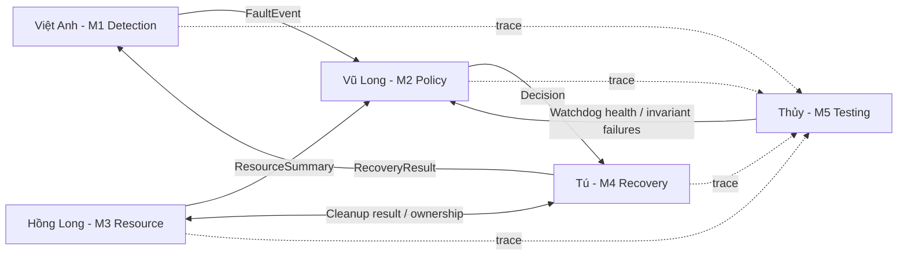

# PHÂN CÔNG CÔNG VIỆC, GIAO DIỆN VÀ QUY ƯỚC LÀM VIỆC NHÓM

> **Đề tài:** Resource-aware Task Selective Fault Recovery (RTSFR) — FreeRTOS Kernel trên STM32  
> **Nhóm:** Tú, Việt Anh, Vũ Long, Hồng Long, Thủy — 05 thành viên  
> **Phiên bản:** 1.0 — 04/11/2026  
> **Tài liệu gốc cần đọc trước:** `01_DAC_TA_HE_THONG_RTSFR.md`  
> **Mục tiêu:** Mỗi người chịu trách nhiệm kỹ thuật một module, giao tiếp qua interface được khóa và tạo được kết quả kiểm chứng riêng. Không để một người làm toàn bộ tích hợp vào tuần cuối.

---

## 1. Phân công chính thức

| Thành viên | Module | Trọng tâm mã kernel | Đầu ra cốt lõi |
|---|---|---|---|
| **Việt Anh** | **Module 1 — Fault Detection & Kernel Integration** | Task registry, progress monitoring, lifecycle integration | Phát hiện và phát event fault chính xác |
| **Vũ Long** | **Module 2 — Fault Classification & Recovery Policy** | Classification, decision state machine, retry budget | Ra quyết định RESTART / SAFE_MODE / RESET nhất quán |
| **Hồng Long** | **Module 3 — Resource Ownership Tracker** | Mutex ownership + managed buffer, resource snapshot | Biết task đang giữ gì và có thu hồi an toàn không |
| **Tú** | **Module 4 — Selective Recovery Manager** | Quiesce, cleanup, delete/recreate, verify, safe-mode | Phục hồi task đủ điều kiện và không restart thiếu an toàn |
| **Thủy** | **Module 5 — Fault Injection, Verification & Watchdog** | Fault campaigns, invariant checks, trace, IWDG | Bộ kiểm thử, số liệu đối chứng, watchdog fallback |

**Điều phối tích hợp chung:** Tú (module 4) làm integration coordinator; **không** có nghĩa Tú phải code thay các module khác. Người sở hữu module có trách nhiệm sửa lỗi integration từ module của mình.

**Vai trò hỗ trợ chéo:** Việt Anh hỗ trợ Tú về `tasks.c`; Hồng Long hỗ trợ Vũ Long về snapshot resource; Thủy hỗ trợ tất cả về test harness và trace.

### 1.1. Nguyên tắc chia việc cân bằng

- M2 có ít dòng code hơn nhưng phải làm **policy table + state model + unit test nhiều nhánh + đánh giá false positives**, không chỉ `switch/case`.
- M5 không chỉ “viết báo cáo”: bắt buộc phát triển **kernel tracing, fault injection có kiểm soát, IWDG và invariant check**.
- M1 không chỉ “tạo task monitor trong app”: bắt buộc **kernel task registry / lifecycle hook / fault event path**.
- M3 không chỉ “đọc tên mutex”: phải có **ownership consistency trong đường queue.c** và ít nhất **một loại resource managed buffer**.
- M4 không chỉ gọi `vTaskDelete()` rồi `xTaskCreate()` mà phải làm **recovery state machine / safety gates / generation verification / safe-mode**.

---

## 2. Sơ đồ quan hệ giữa các module



### 2.1. Không tự phát sinh phụ thuộc vòng

- **M1** không gọi trực tiếp M4; chỉ báo fault event.
- **M2** không gọi `vTaskDelete` hay `xTaskCreate`; chỉ trả decision.
- **M3** không tự restart task; chỉ trả resource summary và cleanup operation **đã được cho phép**.
- **M4** không tự tính lại timeout, không tự đo mutex ownership; gọi M1/M3 theo contract.
- **M5** không sửa policy “chui” để test qua đường sản phẩm; dùng test flags, injection hooks có thể tắt.

### 2.2. Định danh thống nhất

- `task_id`: số ổn định (uint8_t) của **vai trò task**; không dùng địa chỉ task handle làm ID bền vững.
- `generation`: tăng mỗi lần tạo task instance mới.
- `event_id`: duy nhất trong phạm vi phiên firmware/boot; dùng cho correlation log và chống double-recovery.
- `resource_id`: số ổn định cho mutex/buffer được tracker quản lý.
- `run_id`: ID phiên đo kiểm của M5; ghi vào mọi log CSV.

---

## 3. Module 1 — Việt Anh: Fault Detection & Kernel Integration

### 3.1. Mục tiêu module

Giám sát tiến độ thực chất của task, biết thời điểm nào task có dấu hiệu không hoạt động, phát **fault event** theo đúng generation, hạn chế báo nhầm khi task đang chờ hợp lệ; móc vào kernel thay vì chỉ giám sát từ application.

### 3.2. Việc cần làm — theo thứ tự

| ID | Công việc | Đầu ra cụ thể | Độ ưu tiên |
|---|---|---|---|
| M1-01 | Đọc `tasks.c`, TCB, task state, tick APIs, trace hooks | `docs/m1_kernel_analysis.md`: sơ đồ task lifecycle + vị trí hook | P0 |
| M1-02 | Thiết kế task registry: ID, generation, handle, timeout, last progress | `rtsfr_registry_t` + API create/find/update | P0 |
| M1-03 | Triển khai `rtsfr_report_progress()` từ task context; timestamp/seq update atomic | API hoạt động + unit test sequence | P0 |
| M1-04 | Triển khai expected-wait contract (delay/block hợp lệ) | API begin/end expected wait + timeout safety | P0 |
| M1-05 | Viết monitor scan chạy trong kernel-owned supervisor context | Event F01 khi không progress quá hạn | P0 |
| M1-06 | Chống duplicate event, generation stale, tick wrap-around | Tại most một pending fault/generation và test liên quan | P0 |
| M1-07 | Tích hợp lifecycle hooks trong `tasks.c` theo patch tối thiểu | Event create/delete, registry không giữ stale handle | P0 |
| M1-08 | Kiểm thử normal, no-progress, busy-loop, delay hợp lệ | TC01–TC04 + báo cáo đo detection latency | P0 |
| M1-09 | Tối ưu overhead scanning khi số task tăng | Bảng thời gian scan 1/2/3 tasks | P1 |

### 3.3. Đầu vào, đầu ra và API

**Đầu vào:** task descriptor đăng ký, progress report/expected-wait, tick và lifecycle event từ FreeRTOS. Không phụ thuộc M3 để *phát hiện* timeout.

**Đầu ra:** `rtsfr_fault_event_t` cho M2; snapshot health registry cho M4/M5; cập nhật state của instance sau recovery result.

**Contracts:**

```c
rtsfr_status_t rtsfr_register_task(const rtsfr_task_config_t *cfg,
                                    TaskHandle_t task_handle);
rtsfr_status_t rtsfr_report_progress(uint8_t task_id);
rtsfr_status_t rtsfr_begin_expected_wait(uint8_t task_id, TickType_t timeout);
rtsfr_status_t rtsfr_end_expected_wait(uint8_t task_id);
bool rtsfr_detect_pop_event(rtsfr_fault_event_t *event);
void rtsfr_detect_on_new_generation(uint8_t task_id, TaskHandle_t new_handle,
                                     uint16_t new_generation);
```

> **Không được** phát hiện lỗi chỉ vì task chưa được schedule trong 1 tick; cũng không xem context switch là bằng chứng hoàn thành công việc. Trong ứng dụng mẫu, report progress tại cuối một vòng xử lý thành công.

### 3.4. File sở hữu

- `FreeRTOS-Kernel/rtsfr/rtsfr_detect.c`
- `FreeRTOS-Kernel/include/rtsfr_detect.h`
- Phần patch **lifecycle detection** ở `tasks.c` qua PR có review của Tú.
- `tests/host/test_m1_detect.c`, `tests/target/test_m1.c`
- `docs/m1_kernel_analysis.md`

### 3.5. Tiêu chí nghiệm thu

- [ ] Task HEALTHY không phát fault trong thời gian kiểm thử bình thường.
- [ ] F01 và F02 (trong giới hạn còn scheduler/tick) tạo đúng event với task ID/generation.
- [ ] Legitimate wait có khai báo không bị đánh dấu sai; timeout hết hạn được đánh giá lại.
- [ ] Một fault chỉ có một pending event; stale generation event bị loại.
- [ ] Monitor không dùng heap allocation/UART blocking trong hot path.
- [ ] Có `demo_m1` / test độc lập + README + log minh chứng.

**Hạn bàn giao tích hợp đầu tiên:** Cuối tuần 2 phải có bản API ổn định M1→M2 và dữ liệu test.

---

## 4. Module 2 — Vũ Long: Fault Classification & Recovery Policy

### 4.1. Mục tiêu module

Biến dấu hiệu fault thành **quyết định nhất quán, có giải thích và không vi phạm điều kiện an toàn**, dựa trên criticality, resource snapshot, retry budget và trạng thái task.

### 4.2. Việc cần làm

| ID | Công việc | Đầu ra cụ thể | Ưu tiên |
|---|---|---|---|
| M2-01 | Định nghĩa fault types, severity, reason codes | `rtsfr_types.h` hợp tác M1, M4, M5 | P0 |
| M2-02 | Vẽ state machine và bảng quyết định | `docs/m2_policy_table.md` với mọi nhánh | P0 |
| M2-03 | Triển khai pure function `rtsfr_policy_evaluate()` | Decision chính xác, không side effect | P0 |
| M2-04 | Quản lý retry budget theo task ID/generation và time window | Chặn restart loop, reset budget đúng điều kiện | P0 |
| M2-05 | Xử lý “unknown resource”, mutex held, managed buffer reclaimable | Không bao giờ RESTART khi unsafe/unknown | P0 |
| M2-06 | Trạng thái `DEFER`, `SAFE_MODE`, `REQUEST_RESET` | Reason code và hướng xử lý rõ | P0 |
| M2-07 | Kiểm thử policy table bằng host tests | Tối thiểu 15 case, bao gồm boundaries | P0 |
| M2-08 | Phân tích sensitivity với timeout/retry policy | Bảng false alarm/restart count theo tham số | P1 |

### 4.3. Đầu vào/đầu ra/API

**Đầu vào:** `rtsfr_fault_event_t` (M1), `rtsfr_resource_summary_t` (M3), state/retry history (M2).

**Đầu ra:** `rtsfr_decision_t` (M4), thông tin severity và reason code (M5).

```c
rtsfr_decision_t rtsfr_policy_evaluate(
    const rtsfr_fault_event_t *fault,
    const rtsfr_resource_summary_t *resource);
void rtsfr_policy_record_result(uint8_t task_id,
                                 rtsfr_recovery_outcome_t result,
                                 TickType_t tick);
```

**Đặc biệt:** `recovery result` từ M4 chỉ cập nhật thống kê, không được làm event của generation cũ gây restart lặp. Policy không gọi HAL, không tạo task.

### 4.4. Quy tắc an toàn M2 phải cứng hóa

1. `mutex_held_count > 0` ⇒ `RESTART` **bị cấm** trong V2 (trừ nghiên cứu bổ sung được chứng minh riêng, không nằm MVP).
2. `unknown_resource_count > 0` hoặc `has_inflight_io == true` ⇒ **không RESTART**.
3. `can_reclaim_all == false` ⇒ **không RESTART**.
4. `retry_count >= retry_limit` trong cửa sổ quy định ⇒ **không RESTART**.
5. `fault event` không đúng generation đang active ⇒ `IGNORE`.
6. `safe mode` là trạng thái bảo toàn output an toàn, không phải “tùy ý vTaskSuspend mọi task”.

### 4.5. File sở hữu, nghiệm thu

- `rtsfr_policy.c/.h`, `rtsfr_types.h` (type chung cần PR được cả nhóm review).
- `tests/host/test_m2_policy.c`, `docs/m2_policy_table.md`.

- [ ] Đầy đủ decision table, không nhánh không có reason.
- [ ] Unit tests `SAFE`, `UNSAFE`, `UNKNOWN`, `RETRY_EXHAUSTED`, `GENERATION_STALE` pass.
- [ ] Không có `vTaskDelete`, `xTaskCreate`, UART/HAL trong M2.
- [ ] Báo cáo tỉ lệ false-positive theo testcase kiểm thử được M5 tái chạy.

**Hạn bàn giao:** Policy stub cuối tuần 2, full policy cuối tuần 4.

---

## 5. Module 3 — Hồng Long: Resource Ownership Tracker

### 5.1. Mục tiêu module

Cho kernel biết **task nào sở hữu tài nguyên nào**, và quan trọng hơn: có thể chứng minh một tài nguyên còn tồn đọng được cleanup an toàn hay không. Đây là thành phần phân biệt đề tài với heartbeat-based restart đơn giản.

### 5.2. Việc cần làm

| ID | Công việc | Đầu ra cụ thể | Ưu tiên |
|---|---|---|---|
| M3-01 | Đọc `queue.c`, mutex owner, take/give paths | Sơ đồ source-level, xác định điểm hook đúng | P0 |
| M3-02 | Thiết kế resource table bounded theo task_id/generation | Cấu trúc `resource_id`, type, owner, state | P0 |
| M3-03 | Tích hợp cập nhật ownership **sau** mutex take/give thành công | Không miss/duplicate ownership event | P0 |
| M3-04 | Triển khai `rtsfr_resource_snapshot()` | M2/M4 truy vấn an toàn, nhất quán | P0 |
| M3-05 | Cài registered managed-buffer pool kích thước cố định | 8 buffer ví dụ, FREE/OWNED/IN_FLIGHT/QUARANTINED | P0 |
| M3-06 | Thiết kế cleanup contract cho buffer độc quyền | Có thể cleanup khi không có reference ngoài / DMA | P0 |
| M3-07 | Đánh dấu unsafe/unknown cho mutex và shared state | M4 không được tự unlock / reclaim sai | P0 |
| M3-08 | Phối hợp task deletion và generation rollover | Không giữ stale owner pointer sau restart | P0 |
| M3-09 | Invariants, unit tests và report metadata overhead | Test lỗi quyền sở hữu, double-free, in-flight | P0 |
| M3-10 | Tối ưu metadata memory (bitmap / array) | Báo cáo bytes/resource, bounded scan | P1 |

### 5.3. Đầu vào/đầu ra/API

**Đầu vào:** Lifecycle task từ M1/M4, mutex take/give hooks từ kernel, acquire/release của managed-buffer subsystem.

**Đầu ra:** `rtsfr_resource_summary_t`, kết quả cleanup an toàn cho M4, tình trạng resource cho M5.

```c
rtsfr_status_t rtsfr_resource_snapshot(uint8_t task_id,
                                        uint16_t generation,
                                        rtsfr_resource_summary_t *out);
rtsfr_status_t rtsfr_resource_cleanup_safe(uint8_t task_id,
                                            uint16_t generation);
void rtsfr_resource_on_mutex_acquire(uint8_t task_id, uint16_t resource_id);
void rtsfr_resource_on_mutex_release(uint8_t task_id, uint16_t resource_id);
```

**Lưu ý:** `rtsfr_resource_cleanup_safe()` chỉ xử lý **những resource đã được chứng minh cleanup được**, trả lỗi khi có mutex/unknown/in-flight; không phải công cụ tự unlock mọi mutex.

### 5.4. Quy ước và vùng cần chú ý

- `resource_id` là ID do kernel ghi nhận, không nhất thiết là địa chỉ mutex.
- Cập nhật khi `take/give` **thành công**, không cập nhật khi take timeout hoặc fail.
- Không theo dõi “mọi con trỏ heap của mọi task” vì không đủ metadata/hook và dễ sai.
- `ManagedBuffer` chỉ hỗ trợ pool độc quyền; không cho phép DMA in-flight trong bản cleanup được chứng minh.
- Không delete mutex khi có waiter/owner trừ khi đã có chính sách và proof riêng; bản V2 chỉ escalate.
- Resource snapshot phải là ảnh chụp nhất quán tương ứng generation; tránh TOCTOU giữa policy và recovery bằng cách revalidate trước cleanup.

### 5.5. File sở hữu, nghiệm thu

- `rtsfr_resource.c/.h`, `rtsfr_managed_buffer.c/.h` (nếu tách).
- Patch `queue.c` **qua PR có Việt Anh/Tú review**.
- `tests/host/test_m3_resource.c`, `tests/target/test_m3.c`, `docs/m3_resource_contract.md`.

- [ ] Tracker đúng với mutex take/give thành công và timeout.
- [ ] Snapshot báo unsafe khi giữ mutex/unknown hoặc có in-flight IO.
- [ ] Managed buffer cleanup thành công khi độc quyền an toàn; không double-free.
- [ ] Không có logic auto-release mutex.
- [ ] Không đưa dangling `TaskHandle_t` vào metadata sau generation change.
- [ ] Có số liệu RAM tăng và thời gian thêm trong đường mutex.

**Hạn bàn giao:** M3 snapshot v0 cuối tuần 3, đầy đủ mutex/buffer cuối tuần 4.

---

## 6. Module 4 — Tú: Selective Recovery Manager

### 6.1. Mục tiêu module

Thực thi quyết định từ M2 một cách **có thứ tự, an toàn và kiểm chứng được**: ngừng task lỗi trong điều kiện có thể, cleanup tài nguyên an toàn, tạo instance mới và đợi tiến độ xác nhận.

### 6.2. Việc cần làm

| ID | Công việc | Đầu ra cụ thể | Ưu tiên |
|---|---|---|---|
| M4-01 | Đọc `tasks.c`: create/delete, idle cleanup, static/dynamic task | `docs/m4_lifecycle_analysis.md` | P0 |
| M4-02 | Thiết kế recovery state machine với các transitions hợp lệ | `rtsfr_recovery_state_t` và transition table | P0 |
| M4-03 | Thiết kế task descriptor immutable để recreate | Tạo instance mới từ config sạch; generation hợp lệ | P0 |
| M4-04 | Phát triển baseline restart cho task không giữ resource | TC02 pass trước khi M3 hoàn thiện | P0 |
| M4-05 | Chốt luồng `QUIESCING/CLEANUP/RECREATE/VERIFYING` | Recovery pipeline và timeout | P0 |
| M4-06 | Quiesce task và revalidate resource snapshot trước cleanup/recreate | Không xử lý snapshot cũ gây TOCTOU | P0 |
| M4-07 | Cleanup phối hợp M3; safe-mode khi mutex/unknown | Không unlock mutex bừa | P0 |
| M4-08 | Xử lý Idle cleanup / stack/TCB lifetime; OOM | Không use-after-free/leak qua nhiều restart | P0 |
| M4-09 | Anti-double restart và stale generation | Không restart cùng event hai lần | P0 |
| M4-10 | Verify instance mới bằng first progress, không chỉ create return | Báo `RECOVERY_OK` đúng tiêu chí | P0 |
| M4-11 | Triển khai safe-mode output và reset-request interface cho M5 | Hành vi rõ trong lỗi unsafe | P0 |
| M4-12 | Tích hợp toàn nhóm, build/release V0/V1/V2 | PR integration, tags, release notes | P0 |
| M4-13 | Tối ưu restart latency và memory footprint | Đo overhead, xác định tradeoff | P1 |

### 6.3. Đầu vào/đầu ra/API

**Đầu vào:** `rtsfr_decision_t` (M2), `rtsfr_resource_summary_t` / cleanup result (M3), task registry/descriptor (M1), verification result/log (M5).

**Đầu ra:** `rtsfr_recovery_outcome_t` (M1/M2/M5), new task handle/generation (M1/M3), SAFE_MODE / reset request (M5).

```c
rtsfr_status_t rtsfr_recovery_request(const rtsfr_decision_t *decision);
rtsfr_status_t rtsfr_recovery_process(void);
rtsfr_recovery_outcome_t rtsfr_recovery_get_result(uint32_t event_id);
void rtsfr_recovery_on_first_progress(uint8_t task_id, uint16_t generation);
```

`rtsfr_recovery_process()` chạy trong task context thích hợp, không làm việc dài trong `vTaskDelete` hook hoặc ISR.

### 6.4. Chuỗi restart phải triển khai

1. Nhận decision `RESTART` và kiểm tra `event_id/generation`.
2. Chặn nhận decision mới cùng generation.
3. Đưa task instance cũ vào trạng thái không còn được scheduler chọn chạy (**quiesce**) trong điều kiện kernel vẫn tin cậy; nếu không quiesce được ⇒ SAFE_MODE/RESET.
4. **Sau khi quiesce**, re-snapshot resource (M3) và kiểm tra lại `event_id/generation` với trạng thái task đã đóng băng; nếu có mutex/unknown/in-flight ⇒ SAFE_MODE. Snapshot của M2 trước đó chỉ là quyết định sơ bộ.
5. Cleanup resource **chỉ theo contract hợp lệ**; nếu cleanup bất thành ⇒ SAFE_MODE.
6. Xóa task theo FreeRTOS API/semantics đã khóa; bảo đảm heap/TCB/stack lifetime, cho Idle chạy trong trường hợp cleanup deferred.
7. Tạo task mới từ descriptor sạch (nếu OOM ⇒ SAFE_MODE), cập nhật handle/generation dưới synchronization.
8. Chờ first progress; chỉ lúc đó đánh dấu thành công.
9. Log elapsed time, outcome, reason; cập nhật retry history qua M2.

**Không thực hiện:** `vTaskDelete` xong lập tức xTaskCreateStatic dùng lại cùng TCB buffer khi chưa xác nhận instance cũ đã ngừng được tham chiếu.

### 6.5. File sở hữu, nghiệm thu

- `rtsfr_recovery.c/.h`, `rtsfr_safe_mode.c/.h` (tùy chọn), `docs/m4_recovery_state_machine.md`.
- Review/merge mọi patch `tasks.c` để tránh xung đột, nhưng tác giả patch tự chịu chất lượng.
- `tests/target/test_m4.c`.

- [ ] Restart task sạch thành công, task khác tiếp tục chạy.
- [ ] Có generation validation, first-progress verification.
- [ ] Phát hiện và chặn OOM, stale event, duplicate recovery.
- [ ] Không restart task còn giữ mutex/unknown resource.
- [ ] Không có heap leak tích lũy khi kiểm thử lặp.
- [ ] Safe mode đủ rõ để giải thích và demo trên LED/UART.

**Hạn bàn giao:** Restart V1 cuối tuần 3; M4 V2 đầy đủ cuối tuần 6.

---

## 7. Module 5 — Thủy: Fault Injection, Verification & Watchdog

### 7.1. Mục tiêu module

Chứng minh framework thật sự hoạt động, phản ứng đúng với lỗi hỗ trợ, không gây lỗi mới và có hardware fallback khi kernel không thể tự phục hồi.

### 7.2. Việc cần làm

| ID | Công việc | Đầu ra cụ thể | Ưu tiên |
|---|---|---|---|
| M5-01 | Định nghĩa fault model/test suite với cả nhóm | `docs/test_plan.md`, mapping F01–F10 | P0 |
| M5-02 | Viết fault injection command/scenario | `fault_scenarios.c`, build flag test | P0 |
| M5-03 | Thiết kế trace event schema và ring buffer | Log events không block, dropped-event counter | P0 |
| M5-04 | Chạy TC01–TC04 cho M1 và baseline V0/V1 | Log đo detection latency | P0 |
| M5-05 | Viết invariant checker task/resource/generation | Pass/fail, reason code theo invariant | P0 |
| M5-06 | Viết test M3/M4: buffer, mutex, retry, OOM, stale | TC05–TC11, TC13–TC14 | P0 |
| M5-07 | Tích hợp IWDG STM32, chỉ refresh khi healthy | Watchdog reset fallback, ghi reset cause | P0 |
| M5-08 | Thử kernel stall (có kiểm soát trên bo demo) | TC12 thật, không dựa vào simulation giả | P0 |
| M5-09 | Xây script thu UART log + raw CSV + summary | Lặp test, báo median/p95, raw data | P0 |
| M5-10 | So sánh V0/V1/V2; đo CPU/RAM/Flash overhead | `results/summary/benchmark.md` và bảng số liệu | P0 |
| M5-11 | Stress tests nhiều chu kỳ recovery | Báo rò rỉ heap, regression | P1 |

### 7.3. Đầu vào/đầu ra/API

**Đầu vào:** Fault scenario parameters, event logs M1–M4, policy/health status, recovery outcomes, CPU/tick instrumentation.

**Đầu ra:** Injected fault IDs, verification results, watchdog refresh authorization, reset-cause report, raw logs và biểu đồ.

```c
void rtsfr_test_inject(uint8_t test_id);              /* test builds only */
void rtsfr_trace_event(const rtsfr_trace_event_t *e); /* non-blocking, bounded */
bool rtsfr_verify_invariants(void);
bool rtsfr_watchdog_health_gate(void);
```

### 7.4. Các điểm đặc biệt

- IWDG không thể được coi là task-level recovery: nó chỉ reset toàn chip khi chương trình không refresh đúng hạn.
- Chỉ refresh watchdog tại một **health gate** duy nhất. Không có task/ISR “pet watchdog” vô điều kiện.
- Trong SAFE_MODE, nếu output đã an toàn và kernel khỏe, policy có thể cho refresh để giữ safe state; nếu không, ngừng refresh.
- Với reset do IWDG, log UART trước reset có thể thiếu, vì vậy cần đọc/reset cause ở lần boot sau.
- Các phép đo microsecond/cycles dùng timer/DWT có ghi rõ clock và cách reset counter; không dùng `printf()` trực tiếp trong hot path.
- Fault injection không sửa hỏng bộ nhớ kernel thật một cách tùy tiện ở giai đoạn đầu; đặc biệt test HardFault/stack overflow chỉ dùng để kiểm thử **reset fallback**, không hứa safe restart.

### 7.5. File sở hữu, nghiệm thu

- `rtsfr_verify.c/.h`, `rtsfr_trace.c/.h`, `fault_scenarios.c`, `board/iwdg.c`, `tools/collect_log.py`, `docs/test_plan.md`.
- `results/raw/`, `results/summary/`.

- [ ] TC01–TC14 có script/hướng dẫn tái lập, ghi trạng thái PASS/FAIL trung thực.
- [ ] IWDG reset thật và có reset-cause thông báo ở boot sau.
- [ ] Raw data V0/V1/V2 cùng workload, không dùng số đo tự suy diễn.
- [ ] Trace không làm block các hook/critical sections.
- [ ] Có build `TEST` và `RELEASE` tách biệt; production build không kích hoạt injection.

**Hạn bàn giao:** Test harness cuối tuần 2; IWDG đầu tuần 6; benchmark cuối tuần 8.

---

## 8. Hợp đồng giao tiếp giữa thành viên (Interface Contracts)

### 8.1. Giao diện quan trọng nhất phải được khóa sớm

| Giao diện | Bên cung cấp | Bên sử dụng | Ý nghĩa | Hạn chốt |
|---|---|---|---|---|
| `rtsfr_fault_event_t` | Việt Anh (M1) | Vũ Long, Thủy | Fault có task ID/generation/timestamp | Cuối tuần 1 |
| `rtsfr_resource_summary_t` | Hồng Long (M3) | Vũ Long, Tú | Chứng cứ resource-safe/unsafe | Cuối tuần 1 |
| `rtsfr_decision_t` | Vũ Long (M2) | Tú, Thủy | Action + reason + correlation event | Cuối tuần 1 |
| `rtsfr_recovery_outcome_t` | Tú (M4) | Việt Anh, Vũ Long, Thủy | Kết quả restart/verify | Cuối tuần 1 |
| `rtsfr_trace_event_t` | Thủy (M5) | Cả nhóm | Log event format cố định | Cuối tuần 1 |
| `rtsfr_api.h` và `rtsfr_internal.h` | Tú điều phối, cả nhóm review | Cả nhóm | Single source of truth | Đầu tuần 2 |

### 8.2. Hợp đồng về error handling

- Trả về enum `RTSFR_OK`, `RTSFR_ERR_INVALID`, `RTSFR_ERR_STALE`, `RTSFR_ERR_BUSY`, `RTSFR_ERR_UNSAFE`, `RTSFR_ERR_NO_RESOURCE`, `RTSFR_ERR_TIMEOUT`, `RTSFR_ERR_INTERNAL`.
- Không trả `0` mang nhiều nghĩa; error code phải được document trong header.
- Khi **không biết trạng thái resource**, trả `UNSAFE/UNKNOWN`, không tự suy ra safe.
- Không swallow error trong recovery. Tất cả lỗi phải có `reason_code` và trace event.
- Tất cả event/decision/outcome mang `task_id`, `generation` và `event_id` để có thể kết nối log.

### 8.3. Hợp đồng về concurrency

- Thông tin cập nhật giữa task context và ISR phải có quy tắc atomic/critical rõ; **không dùng `volatile` thay cho synchronization**.
- Không `malloc/free` hay UART blocking trong critical section hoặc kernel hook nhạy cảm.
- Không gọi API chỉ dành cho task context trong ISR. Nếu cần ISR, cung cấp `...FromISR` riêng, review kỹ.
- Không dùng mutex application để bảo vệ RTSFR metadata vì có thể tạo dependency vòng với task đã lỗi. Ưu tiên critical sections ngắn/atomic phù hợp platform.
- Tất cả “snapshot + quyết định + commit” cần **revalidation** tại M4 **sau khi task đã quiesce, trước cleanup/recreate**. Quyết định M2 chỉ là sơ bộ khi task còn chạy.
- Mỗi hook phải có giới hạn thời gian/độ phức tạp ước lượng và M5 có bài đo overhead.

### 8.4. Hợp đồng về lifecycle

1. `task_id` không đổi qua restart, `generation` tăng, `TaskHandle_t` có thể đổi.
2. M1 là nơi cung cấp registry, M4 là nơi quyết định tạo instance mới; không có hai module cùng gọi create.
3. M3 cleanup resource chỉ theo instruction hợp lệ từ M4 và hợp đồng an toàn.
4. M2 quyết định nhưng không mutate task.
5. M5 quan sát/inject, không thay đổi logic production âm thầm.

### 8.5. API naming và file visibility

- Public application-facing APIs bắt đầu `rtsfr_`, khai báo trong `rtsfr_api.h`.
- Internal module helpers bắt đầu `rtsfr_<module>_`, khai báo trong `rtsfr_internal.h` hoặc header nội bộ nhỏ.
- Mỗi function trong public/internal header phải có comment: **purpose / input / output / context (task/ISR) / blocking / side effects**.
- `static` cho private symbols, không export global tùy tiện; không include trực tiếp `.c`.
- Không để ứng dụng tự include TCB private structures.

---

## 9. Quy ước Git, mã nguồn và review

### 9.1. Repository và nhánh

**Bắt buộc dùng một repository chung.**

```text
main                 # chỉ chứa bản đã build/test tích hợp
├── develop          # nhánh tích hợp thường xuyên
├── feat/m1-detection-viet-anh
├── feat/m2-policy-vu-long
├── feat/m3-resource-hong-long
├── feat/m4-recovery-tu
└── feat/m5-verification-thuy
```

- `main`: bảo vệ được / release. Không push trực tiếp.
- `develop`: tích hợp các PR, phải build được sau mỗi merge.
- `feat/mX-*`: branch ngắn, bám theo một issue; không giữ nhánh 3–4 tuần mà không PR.
- Các tag: `v0-baseline`, `v1-basic-recovery`, `v2-resource-aware`, `v2-final`.

### 9.2. Commit và Pull Request

Commit format:

```text
M1: add generation-aware task progress registry
M2: reject restart when task holds unsafe resources
M3: track successful FreeRTOS mutex take/give
M4: implement recovery verification state
M5: add watchdog reset-cause test
```

**PR phải có:**

- Nội dung sửa; module và test case liên quan.
- Lý do thay đổi kernel và những file bị ảnh hưởng.
- Giao diện cũ/mới; cách test độc lập.
- Kết quả build (Keil/GCC nếu có), RAM/Flash ảnh hưởng nếu làm hot path.
- Chỉ rõ những giới hạn hoặc vấn đề chưa xử lý.

**Review tối thiểu:** 1 người khác approve; PR sửa `tasks.c` hoặc `queue.c` phải được Tú + chủ module liên quan review; ai tự viết thì không tự approve.

### 9.3. Ai được sửa file nào?

| File / vùng | Owner | Quy tắc |
|---|---|---|
| `rtsfr_detect.c/.h` | Việt Anh | Người khác sửa bằng PR có tag owner |
| `rtsfr_policy.c/.h` | Vũ Long | Tách bảng policy riêng, không viết inline ở recovery |
| `rtsfr_resource.c/.h` | Hồng Long | Bất kỳ thay đổi cleanup contract phải Tú review |
| `rtsfr_recovery.c/.h` | Tú | M1/M3 review thao tác lifecycle/resource |
| `rtsfr_verify.c`, `rtsfr_trace.c`, `board/iwdg.c` | Thủy | Test build phải không ảnh hưởng release build |
| `tasks.c` | **Việt Anh & Tú** (Tú phụ trách merge cuối) | Mỗi PR một hook nhỏ, build ngay, không thay file hàng loạt |
| `queue.c` | **Hồng Long** (Tú review) | Hook after-success; tránh phá mutex behavior |
| `rtsfr_api.h`, `rtsfr_internal.h` | **Tú điều phối** | Chỉ sửa sau review cả nhóm, tăng interface version |
| `FreeRTOSConfig.h`, startup, CubeMX | **Tú + Thủy** | Không tự đổi cấu hình clock/tick/stack |
| `docs/`, `tests/` | Người phụ trách module | PR phải kèm docs/test thuộc module |

### 9.4. C Coding Standard

- C99/C11 tùy compiler có xác nhận; `stdint.h`, `stdbool.h` nếu toolchain hỗ trợ, bật warning ở mức hợp lý.
- Tên hàm và biến kiểu `snake_case` với prefix `rtsfr_`; enum `RTSFR_...`; macro config `configRTSFR_...`.
- Không dùng magic numbers; tất cả timeout/retry/resource limit qua config/header.
- Kiểm tra null, bounds, generation trước khi dereference.
- Không cấp phát trong ISR hoặc critical hooks; tránh recursion, VLA lớn trên stack.
- Các array/struct lớn phải cân đối **20 KB SRAM**; báo kích thước `sizeof` và map.
- Code thật phải có comment *vì sao phải làm*, không chỉ comment mô tả từng dòng.
- Mọi thay đổi kernel gốc phải kèm `/* RTSFR BEGIN: ... */` / `/* RTSFR END */` hoặc một patch diff dễ xác định; không tự sửa code upstream ngoài phạm vi.
- `configASSERT()` dùng để bắt bất biến khi debug; runtime release vẫn cần graceful failure/safe-mode cho lỗi dự kiến.
- Không được “tắt warning” để build qua nếu có lỗi logic nghiêm trọng.

### 9.5. Quy ước môi trường build

1. Một **FreeRTOS tag + commit SHA** do Tú ghi `docs/build_environment.md`, không ai tự cập nhật.
2. CubeMX config, clock, tick rate, heap_4, scheduler priorities dùng chung.
3. Mục tiêu chính Keil µVision5; file Keil project được commit (trừ file user-specific/temp).
4. Toolchain compiler major version, optimization flags và linker map được ghi trong README; không so benchmark khác optimization mà không công bố.
5. Không trộn FreeRTOS source do CubeMX sinh với fork sửa tay. Một đường source kernel duy nhất.
6. Build configs: `DEBUG_TEST`, `RELEASE_DEMO`, `BENCHMARK` với IWDG/injection/log khác nhau ghi rõ; không tự tắt watchdog rồi gọi đó là pass TC12.
7. Dùng timer/tick clock thống nhất; đo bằng `HAL_GetTick` và FreeRTOS tick lẫn nhau mà không hiệu chỉnh có thể tạo số liệu sai.

---

## 10. Chuẩn đầu vào–đầu ra khi giao việc

Mỗi task/issue trên GitHub Projects/Markdown phải ghi đủ 8 mục:

```markdown
### [M3-04] Resource snapshot
- Owner: Hồng Long
- Goal: M2/M4 lấy được trạng thái tài nguyên nhất quán của task
- Inputs: task_id, generation, current resource table
- Outputs: rtsfr_resource_summary_t + error code
- Depends on: M3-02; rtsfr_internal.h version X
- Files: rtsfr_resource.c, rtsfr_resource.h
- Tests: unit snapshot, mutex-held, stale-generation, unknown-resource
- Done when: build success + tests pass + PR reviewed/merged + docs updated
```

**Không giao việc dạng “nghiên cứu module” mà không có outputs hoặc test.**

### 10.1. Quy trình khi một module chưa xong

- Module tiếp theo code dựa trên **mock/stub đúng signature** đã khóa, không chờ bên khác hoàn thiện toàn bộ.
- Stub phải ghi `RTSFR_NOT_IMPLEMENTED` hoặc dữ liệu test cố định minh bạch, không trả `RTSFR_OK` giả.
- Khi PR module thật merge, thay stub qua integration test với test cases hợp đồng.
- Nếu thay API, mở issue/RFC nhỏ; Tú điều phối, ít nhất M1/M2/M3/M4 owner liên quan chấp thuận; cập nhật cả 2 bên cùng PR hoặc PR nối tiếp có compile gate.

---

## 11. Lịch công việc 8 tuần chi tiết theo thành viên

> Kế hoạch mẫu khi 5 người đã có nền C/STM32 và có thể dành thời gian hàng tuần. Điều chỉnh theo thời hạn chính thức; không giảm test ở tuần cuối.

| Tuần | Việt Anh (M1) | Vũ Long (M2) | Hồng Long (M3) | Tú (M4) | Thủy (M5) |
|---|---|---|---|---|---|
| **W1** | Đọc `tasks.c`, registry design, fault event | Fault types + policy table v0 | Đọc `queue.c`, resource model | Baseline board + kernel pin, recovery state machine | Test plan + UART log schema + TC01 |
| **W2** | Progress/expected-wait scan, event queue | Policy stub + retry logic | Resource snapshot mock + metadata | Restart task sạch V1 + hook contracts | Injection no-progress + TC02–04 |
| **W3** | Lifecycle hook + stale generation tests | Full policy decision branch tests | Mutex hooks + resource snapshots | Pipeline `QUIESCE→CLEANUP` + M1 integration | Invariant checker, benchmark harness |
| **W4** | Optimize scan + integration fixes | Policy unsafe/unknown + reason codes | Managed buffer pool + cleanup contract | Revalidate snapshot, verify-new-instance | TC05–10 + result collection |
| **W5** | Stabilize monitor and event overflow | Retry window / SAFE_MODE policy | Buffer quarantine + resource invariants | Recovery error paths + safe-mode control | IWDG config + reset reason |
| **W6** | Monitor regression | Policy regression/edge cases | Resource stress test | V2 integrated firmware + full lifecycle | TC11–14 + watchdog fallback |
| **W7** | Measure detection latency/overhead | Analyze false alarms/retry behavior | Resource overhead/heap stability | End-to-end V0/V1/V2 builds + integration fixes | Raw benchmark 30+ runs, scripts |
| **W8** | Viết phần M1, diagram | Viết phần M2 + policy eval | Viết phần M3 + invariants | Architecture, integration, report assemble, demo | Graphs, results, reproduction checklist |

### 11.1. Giai đoạn kiểm soát (integration gates)

| Gate | Hạn | Điều kiện để qua |
|---|---|---|
| **G0 — Baseline** | Cuối W1 | FreeRTOS V0 chạy 3 tasks + UART; commit/tag; compiler/clock khóa |
| **G1 — Interface freeze** | Đầu W2 | 5 contracts/types thống nhất, stub builds |
| **G2 — V1** | Cuối W3 | No-progress phát hiện + restart task sạch; TC01–04 pass |
| **G3 — Resource-safe policy** | Cuối W4 | Mutex/managed-buffer snapshot đúng; unsafe không restart; TC05–10 |
| **G4 — V2** | Cuối W6 | Recovery state, watchdog, safe-mode, test matrix hoàn chỉnh |
| **G5 — Report release** | Cuối W8 | V0/V1/V2 benchmark + raw data + reproducible build + demo |

**Quy tắc dự phòng:** Nếu cuối W4 M3/M4 chưa chứng minh cleanup an toàn, bỏ chức năng auto-reclaim buffer khỏi bản demo cuối nhưng vẫn giữ **resource-aware refusal/safe-mode**, hoàn thiện và đánh giá minh bạch; không để lỗi unsafe làm hỏng toàn hệ thống.

---

## 12. Quy trình phối hợp và giao tiếp hàng tuần

### 12.1. Nhịp nhóm

- **Đầu tuần (20–30 phút):** xác nhận issue ưu tiên và interface thay đổi; nói rõ blocker.
- **Giữa tuần (10–15 phút):** mỗi người demo 1 thay đổi trên nhánh mình; không chỉ báo “đang làm”.
- **Cuối tuần (30–45 phút):** merge có review, chạy smoke tests, cập nhật test results và những gì còn lỗi.
- **Hằng ngày khi có làm việc:** cập nhật ngắn `Done / Next / Blocker` trong issue/chat nhóm; không cần họp dài.

### 12.2. Quy tắc phát hiện blocker

Nếu thiếu API/hook từ người khác:

1. Tạo issue `BLOCKER: tên interface + module + cần khi nào`.
2. Kèm mock signature và output dự kiến; không tự ý sửa code module khác.
3. Thông báo owner liên quan và Tú; có phản hồi/đề xuất interface trong **một buổi làm việc nhóm kế tiếp**.
4. Nếu chưa tích hợp được, tiếp tục unit tests với mock; ghi giới hạn trung thực.

### 12.3. Review khi sửa kernel cốt lõi

Checklist PR `tasks.c` / `queue.c`:

- [ ] Thay đổi có đúng **hook point** không (mutex success, task lifecycle đúng state)?
- [ ] Có làm việc tốn thời gian trong ISR / critical section không?
- [ ] Có cập nhật metadata **trước/sau** FreeRTOS state change đúng thứ tự không?
- [ ] Có tạo pointer stale khi delete/recreate không?
- [ ] Có giữ FreeRTOS API contract với ứng dụng khác không?
- [ ] Có test timeout, failure path, compile under disabled feature flag không?
- [ ] Có baseline regression: queue, semaphore, mutex, ordinary task creation/deletion chạy như cũ không?

---

## 13. Test plan phân trách nhiệm và tiêu chí bằng chứng

| Test ID | Tác giả test chính | Module liên quan | Bằng chứng bắt buộc |
|---|---|---|---|
| TC01 Normal operation | Thủy | M1/M5 | 5 phút khỏe mạnh, không false alarm |
| TC02 No-progress restart | Việt Anh + Thủy | M1/M2/M4 | Trace fault/restart/first progress |
| TC03 Busy-loop detect | Việt Anh + Thủy | M1/M4 | Log supervisor vẫn chạy, restart được |
| TC04 Expected wait | Việt Anh | M1/M2 | Không báo lỗi sai |
| TC05 Managed buffer reclaim | Hồng Long + Tú | M3/M4 | Buffer count trước/sau, generation mới |
| TC06 Mutex held → SAFE_MODE | Hồng Long + Vũ Long | M2/M3/M4 | Không unlock, reason code đúng |
| TC07 Retry budget | Vũ Long | M2/M4 | Stop restarts sau giới hạn |
| TC08 Create failure | Tú | M4/M2 | Không leak, SAFE_MODE |
| TC09 Race: late progress | Việt Anh + Tú | M1/M4 | Cancel fault nếu safe hợp lệ |
| TC10 Stale generation event | Tú | M1/M2/M4 | Không double restart |
| TC11 Repeated cleanup/heap | Tú + Thủy | M3/M4/M5 | Heap trend 100 cycles |
| TC12 IWDG fallback | Thủy | M5 | Reset thật + reset cause |
| TC13 Event queue saturation | Việt Anh + Thủy | M1/M5 | Overflow visible/fail-safe |
| TC14 Resource invariants | Hồng Long + Thủy | M3/M5 | Không double ownership/free |

**Bằng chứng không hợp lệ:** “Em đã nhìn thấy LED sáng vài lần”. Mỗi test cần `test_id`, bước chạy, `expected`, `actual`, verdict, bản build/tag và raw log nếu có.

### 13.1. Mẫu biên bản test

```markdown
Test ID: TC06
Build: v2-resource-aware @ <commit-SHA>
Board: STM32F103C8T6 / CPU clock: 72 MHz / tick: ... Hz
Setup: ControlTask có mutex M1 và ngừng report progress
Expected: FAULT_DETECTED -> RESOURCE_UNSAFE -> SAFE_MODE; no automatic mutex release
Actual: <điền từ log thực>
Verdict: PASS / FAIL / NOT_RUN
Evidence: results/raw/tc06_<run_id>.csv
Owner: Hồng Long + Vũ Long + Thủy
```

### 13.2. Benchmark công bằng

- Cùng bo, cùng clock, compiler optimization, stack, workload và instrumentation tương đương ở V0/V1/V2.
- Ghi rõ fault detection latency chỉ có nghĩa ở V1/V2; không lấy V0 làm 0 ms.
- Đo median/p95 và n (số lần chạy); lưu raw logs, không chỉ chụp màn hình.
- Ghi overhead RAM/Flash bằng linker map; CPU overhead qua cycle/timer có giới hạn và chú thích.
- Sai số IWDG do LSI, xử lý riêng với thuật toán detection theo FreeRTOS tick.

---

## 14. Demo trước giảng viên — ai trình bày gì?

| Thứ tự | Người | Nội dung thể hiện | Thời lượng gợi ý |
|---|---|---|---|
| 1 | Tú | Vấn đề, kiến trúc, tại sao sửa kernel, state machine | 2–3 phút |
| 2 | Việt Anh | TCB/registry, progress detection, no-progress vs legitimate wait | 2 phút |
| 3 | Vũ Long | Policy RESTART/SAFE_MODE/RESET, retry và reason codes | 2 phút |
| 4 | Hồng Long | Resource owner/managed buffer, lý do không auto-unlock mutex | 2 phút |
| 5 | Thủy | Fault injection F01/F05/F06, watchdog reset, benchmark V0/V1/V2 | 3–4 phút |
| 6 | Tú / cả nhóm | Demo end-to-end, giới hạn, câu hỏi | 2 phút + Q&A |

**Đồ vật cần có:** bo STM32, ST-LINK, USB-UART, nguồn, dây, laptop đã flash sẵn 3 firmware, script log, sơ đồ khối và biểu đồ. Không đổi nhiều firmware ngay trong phần demo nếu thời gian ngắn; chuẩn bị chế độ demo có lệnh chọn scenario.

---

## 15. Các lỗi tổ chức nhóm thường gặp — cách phòng tránh

| Sai lầm | Phòng tránh |
|---|---|
| 5 người dùng 5 bản FreeRTOS khác nhau | Tag/commit khóa; một repo, một source kernel |
| M1/M4 cùng sửa `tasks.c` không review | Mỗi patch nhỏ qua PR, Tú merge cuối, CI/smoke test |
| M2 chỉ viết policy khi M3 xong | M2 dùng mock `ResourceSummary` ngay từ W1 |
| M3 giả định mọi mutex có thể release | UNSAFE mặc định; không auto-unlock |
| M4 dùng static TCB/stack lại quá sớm | Dynamic task baseline, xác nhận idle cleanup; kiểm tra lifetime |
| M5 chỉ đến tuần cuối mới test | Injection và test plan phải có từ W1–W2 |
| Demo thành “watchdog reset là đã recovery” | Phải có demo restart riêng task và chứng cứ task khác tiếp tục |
| Quá nhiều feature nhưng không có benchmark | Freeze scope W4–W5, giữ V0/V1/V2 và raw data |
| Không biết phần nào là kernel work | Mỗi module có file kernel, hooks, design doc và Git diff |
| Chỉ test success path | Mỗi module có failure tests và invariant checks |

---

## 16. Checklist trước khi nhóm bắt đầu code

- [ ] Cả 5 người đọc toàn bộ `01_DAC_TA_HE_THONG_RTSFR.md` và ghi 3 chỗ chưa rõ.
- [ ] Chọn đúng chip/board, xác thực bộ nhớ và toolchain; FreeRTOS V0 build chạy được.
- [ ] Tú tạo repo chung, `README.md`, `develop`, branch policies và issue template.
- [ ] Cả nhóm thống nhất `task_id`, `generation`, `event_id`, `resource_id`.
- [ ] M1/M2/M3/M4/M5 thống nhất header contracts; PR khóa `rtsfr_api.h` và `rtsfr_internal.h`.
- [ ] M5 đưa 14 test cases vào `docs/test_plan.md` với owner/test evidence.
- [ ] Mỗi module có thể compile với stub của các module khác.
- [ ] Chạy TC01/TC02 trên FreeRTOS gốc và ghi raw baseline.
- [ ] Giao nhiệm vụ bằng **issue có input/output/tests/done**, không chỉ giao theo tên module.
- [ ] Ấn định họp kỹ thuật cuối tuần và quy tắc review kernel.

---

## 17. Định nghĩa hoàn thành của từng thành viên

Mỗi người chỉ được đánh dấu `DONE` khi có đủ 6 yếu tố:

1. **Code:** implementation có thật trong module/patch kernel, không chỉ slides.
2. **Interface:** đúng signature, enum và context rules đã khóa.
3. **Test:** unit/integration tests theo module có kết quả PASS; trường hợp FAIL phải ghi issue.
4. **Docs:** flow, assumptions, limitations, files changed, RAM/CPU cost nếu có.
5. **Integration:** PR được review, merge vào `develop`, toàn project build và smoke test pass.
6. **Evidence:** log/ảnh biểu đồ/kết quả có thể tái lập từ release tag; có thể tự thuyết trình module của mình.

### 17.1. Mốc MVP khi sắp hết thời gian

Nếu thời hạn bị rút ngắn, tập trung các phần **bắt buộc** để vẫn đúng đề tài:

- M1: progress detection + expected wait + fault event/generation.
- M2: policy safe/unsafe + retry.
- M3: resource snapshot mutex + 1 managed buffer.
- M4: restart task sạch, refuse unsafe resource, verify new generation.
- M5: TC01/TC02/TC04/TC05/TC06/TC07/TC12 + UART log + watchdog.

Có thể giảm graph/report đẹp, số task demo, trace ring length hoặc tính năng nâng cao; **không bỏ safety gate, kernel integration, baseline đối chứng**.

---

## 18. Quy trình release cuối cùng

1. **Code freeze:** Không thêm feature mới sau khi xác nhận 14 test cases và build.
2. **Regression:** Cả nhóm chạy V0/V1/V2 trên một board đã xác nhận, lưu log mỗi lần.
3. **Audit:** `git diff` so với FreeRTOS upstream; kiểm tra không còn debug hacks và hard-coded task handles.
4. **Build artifact:** Lưu `.hex`/`.bin`, linker `.map`, project Keil, commit SHA, firmware version và build flags.
5. **Kết quả:** `results/raw/*.csv`, `results/summary/benchmark.md`, slide + report hoàn thiện.
6. **Reproduction:** Từ clone sạch, một người khác trong nhóm build và chạy TC02/TC06/TC12 thành công.
7. **Tag:** `v2-final` và ghi changelog + known limitations.
8. **Bàn giao:** Hai tài liệu Markdown này, mã nguồn, test, demo video, bảng phân công đóng góp.

---

## 19. Các liên kết tham chiếu cần cả nhóm đọc

- FreeRTOS kernel: https://github.com/FreeRTOS/FreeRTOS-Kernel
- FreeRTOS tasks.c: https://github.com/FreeRTOS/FreeRTOS-Kernel/blob/main/tasks.c
- FreeRTOS queue.c: https://github.com/FreeRTOS/FreeRTOS-Kernel/blob/main/queue.c
- FreeRTOS Idle Task: https://github.freertos.org/Documentation/02-Kernel/02-Kernel-features/01-Tasks-and-co-routines/15-Idle-task
- FreeRTOS static/dynamic allocation: https://www.freertos.org/Documentation/02-Kernel/02-Kernel-features/09-Memory-management/03-Static-vs-Dynamic-memory-allocation
- STM32F103 reference: https://www.st.com/en/microcontrollers-microprocessors/stm32f103c8.html
- STM32 RM0008 (IWDG): https://www.st.com/resource/en/reference_manual/rm0008-stm32f103xx-advanced-armbased-32bit-mcus-stmicroelectronics.pdf
- Hopter RTOS: https://github.com/hopter-project/hopter
- Kernel fault injection research (2026): https://arxiv.org/abs/2603.25666

> **Kỷ luật kỹ thuật cốt lõi:** Nếu không chứng minh được một task có thể restart an toàn, **đừng restart**. Đưa vào SAFE_MODE hoặc reset theo policy; làm đúng một bộ test quan trọng hơn việc tuyên bố “tự phục hồi mọi lỗi”.
