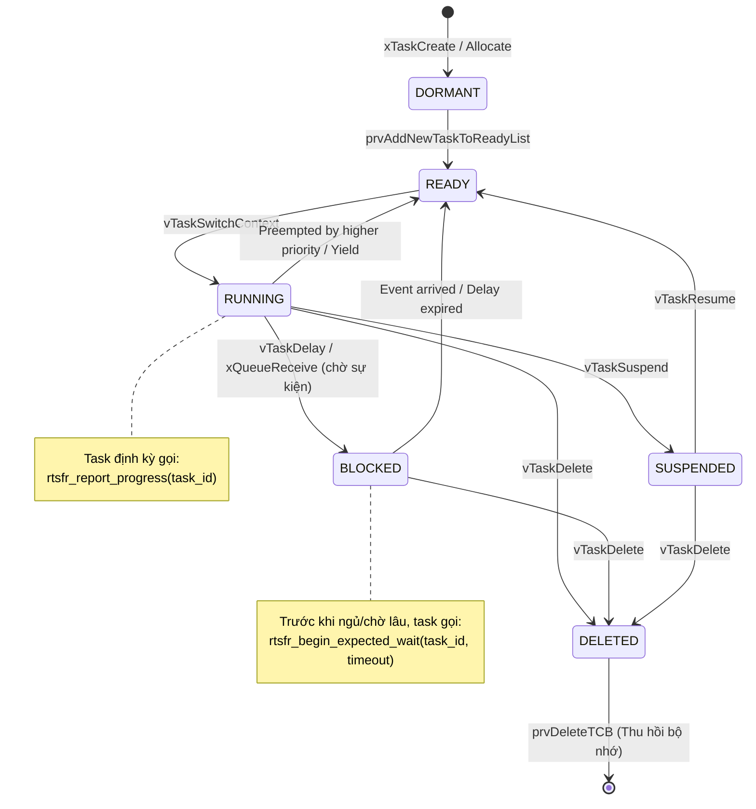

# Phân tích FreeRTOS Kernel & Thiết kế Module 1 (M1-01)

> **Tài liệu:** Khảo sát Kernel FreeRTOS V10.3.1 phục vụ cơ chế Giám sát tiến độ & Tích hợp vòng đời task (RTSFR Module 1)  
> **Tác giả:** Việt Anh (Module 1 Lead)  
> **Tham chiếu:** `firmware/Middlewares/Third_Party/FreeRTOS/Source/tasks.c`, `01_DAC_TA_HE_THONG_RTSFR.md`

---

## 1. Bản chất vấn đề: Tại sao FreeRTOS mặc định không phát hiện được Task bị kẹt?

Trong FreeRTOS nguyên bản:
1. **Scheduler chỉ quan tâm đến trạng thái lập lịch (Scheduling State):**
   - Một task có thể ở trạng thái `Ready`, `Running`, `Blocked` (chờ sự kiện/delay), hoặc `Suspended`.
   - Nếu một task bị **vòng lặp vô hạn (Infinite Loop)** hoặc **kẹt logic (Livelock)**:
     - Task này vẫn liên tục tiêu thụ CPU (nếu là task ưu tiên cao nhất) hoặc vẫn được chuyển ngữ cảnh (context switch) bình thường.
     - Scheduler không thể biết được task đó có đang làm việc có ích (useful progress) hay đang chạy quẩn!
2. **Watchdog truyền thống (IWDG/WWDG):**
   - Chỉ bảo vệ toàn hệ thống: Nếu bất kỳ task nào (hoặc một task giám sát chung) refresh watchdog, vi điều khiển sẽ không reset.
   - Nếu task giám sát dùng cơ chế polling lỏng lẻo, hoặc nếu watchdog bị đá tự động trong ngắt SysTick, task ứng dụng chết nhưng vi điều khiển vẫn tưởng hệ thống đang chạy tốt.
   - Ngược lại, nếu Watchdog cắn, toàn bộ chip bị reset, làm sập cả các task điều khiển thiết yếu khác đang chạy hoàn hảo.

**Mục tiêu của Module 1:** Bổ sung giác quan cho Kernel để nhận biết **tiến độ thực chất (Real Progress)** của từng task riêng lẻ.

---

## 2. Vòng đời Task trong FreeRTOS & Điểm tích hợp RTSFR



---

## 3. Lựa chọn kiến trúc: Registry độc lập vs Thay đổi cấu trúc TCB

Có 2 phương án tích hợp dữ liệu giám sát:

| Tiêu chí | Phương án A: Thêm trường vào `TCB_t` trong `tasks.c` | Phương án B: Thiết kế `rtsfr_registry_t` độc lập (Được chọn) |
|---|---|---|
| **Can thiệp Kernel** | Sửa trực tiếp struct private của FreeRTOS, vi phạm tính đóng gói. | Không chạm vào layout của TCB; Registry tách biệt sạch sẽ. |
| **Bảo trì / Nâng cấp** | Dễ vỡ khi cập nhật kernel hoặc đổi phiên bản FreeRTOS. | Dễ bảo trì, dễ viết Unit Test trên Host độc lập. |
| **Chi phí bộ nhớ** | Tăng kích thước TCB của MỌI task (kể cả Idle Task, Timer Task). | Chỉ tốn RAM cho các task cần giám sát (`configRTSFR_MAX_TRACKED_TASKS`). |
| **Độ an toàn** | Nếu task ghi tràn stack làm hỏng TCB, dữ liệu monitor hỏng theo. | Bảng Registry nằm ở phân vùng bss độc lập. |

**Quyết định:** Chọn **Phương án B**. Registry độc lập quản lý tối đa 4–8 task, ánh xạ thông qua `TaskHandle_t` và định danh logic `task_id` (0..N-1).

---

## 4. Thiết kế Task Registry (`rtsfr_registry_t`)

Mỗi bản ghi (`rtsfr_task_record_t`) gồm các trường sau:

```c
typedef enum {
    RTSFR_TASK_STATE_UNREGISTERED = 0,
    RTSFR_TASK_STATE_HEALTHY,        /* Task đang chạy và báo tiến độ đều đặn */
    RTSFR_TASK_STATE_EXPECTED_WAIT,   /* Task đang trong trạng thái chờ hợp lệ có khai báo */
    RTSFR_TASK_STATE_FAULTY,          /* Task đã bị phát hiện quá hạn tiến độ (đã phát event) */
    RTSFR_TASK_STATE_QUIESCED         /* Task đang bị cô lập chuẩn bị hồi phục (Module 4) */
} rtsfr_task_state_t;

typedef struct {
    uint8_t             task_id;            /* ID logic cố định của nhiệm vụ (0..MAX-1) */
    uint16_t            generation;         /* Số thế hệ của task (tăng mỗi lần recreate) */
    TaskHandle_t        task_handle;        /* Con trỏ FreeRTOS TaskHandle hiện tại */
    TickType_t          timeout_ticks;      /* Thời hạn tối đa cho phép giữa 2 lần report */
    TickType_t          last_progress_tick; /* Tick gần nhất task gọi report progress */
    TickType_t          expected_wait_deadline; /* Hạn chót nếu task đang chờ hợp lệ */
    uint32_t            progress_seq;       /* Bộ đếm số chu kỳ xử lý thành công */
    rtsfr_task_state_t  state;              /* Trạng thái giám sát hiện thời */
    bool                fault_pending;      /* Cờ đánh dấu đã gửi sự kiện lỗi đi hay chưa */
} rtsfr_task_record_t;
```

---

## 5. Giải quyết các thách thức kỹ thuật cốt lõi

### 5.1. Xử lý Tick Wrap-around an toàn
Biến đếm Tick của FreeRTOS (`TickType_t`) là kiểu nguyên không dấu 32-bit (`uint32_t`). Sau khoảng 49.7 ngày (ở tần số 1000Hz), giá trị sẽ tràn về 0.
Để kiểm tra timeout an toàn tuyệt đối trong toán học số học bù hai (two's complement):
```c
/* Luôn dùng phép trừ không dấu */
TickType_t elapsed = xCurrentTick - p_record->last_progress_tick;
if (elapsed > p_record->timeout_ticks) {
    /* Đã quá hạn! */
}
```
*Lưu ý: Điều này đúng với điều kiện `timeout_ticks < (0xFFFFFFFF / 2)` — hoàn toàn thỏa mãn vì timeout thực tế chỉ từ vài trăm ms đến vài giây.*

### 5.2. Chống Race Condition giữa Task Context và Monitor Scan
- Hàm `rtsfr_report_progress(task_id)` được gọi từ ngữ cảnh của từng Task.
- Hàm `rtsfr_detect_scan()` được gọi định kỳ từ ngữ cảnh của **Supervisor Task**.
- Để bảo vệ việc đọc/ghi `last_progress_tick`, `progress_seq` và `state`:
  - Dùng **Critical Section cực ngắn** (`taskENTER_CRITICAL()` / `taskEXIT_CRITICAL()`).
  - Tuyệt đối không gọi bất kỳ API blocking hay I/O nào bên trong critical section này.

### 5.3. Hợp đồng Chờ hợp lệ (Expected-Wait Contract)
Khi một Task chuẩn bị gọi `vTaskDelay(500)` hoặc chờ gói tin từ UART/I2C trong 1000ms:
1. Task gọi: `rtsfr_begin_expected_wait(task_id, 1000);`
   - Registry cập nhật `state = RTSFR_TASK_STATE_EXPECTED_WAIT`.
   - `expected_wait_deadline = xCurrentTick + 1000`.
2. Task thực hiện chờ: `vTaskDelay(pdMS_TO_TICKS(500));`
3. Khi thức dậy: Task gọi `rtsfr_end_expected_wait(task_id);`
   - Registry cập nhật lại `last_progress_tick = xCurrentTick`.
   - Chuyển `state = RTSFR_TASK_STATE_HEALTHY`.
4. Nếu task chờ quá `expected_wait_deadline` mà không gọi `end`: Bộ quét sẽ phát hiện và kích hoạt fault `RTSFR_FAULT_WAIT_TIMEOUT`.

### 5.4. Chống Stale Event bằng `generation`
Khi Module 4 (Recovery) tiêu hủy một task instance và tạo lại một task mới:
- Module 4 thông báo: `rtsfr_detect_on_new_generation(task_id, new_handle, new_generation);`
- `generation` tăng lên (ví dụ từ 1 lên 2).
- Mọi event cũ mang `generation = 1` còn sót lại trong hàng đợi của Module 2 sẽ tự động bị Module 2 bỏ qua (Ignore).

---

## 6. Điểm chèn Hook dự kiến trong Kernel (`tasks.c`)

Mặc dù Registry có thể được đăng ký thủ công qua API `rtsfr_register_task`, việc tích hợp trực tiếp vào Kernel giúp hệ thống tự động nhận biết khi task bị xóa ngoài ý muốn:

1. **Khi Task bị xóa (`vTaskDelete` trong `tasks.c`):**
   ```c
   /* RTSFR BEGIN: Lifecycle sync */
   #if ( configUSE_RTSFR == 1 )
   rtsfr_detect_on_task_delete( ( TaskHandle_t ) pxTCB );
   #endif
   /* RTSFR END */
   ```
   Điều này giúp Registry lập tức chuyển task sang trạng thái hủy và vô hiệu hóa handle, tránh tình trạng dangling pointer.

2. **Khi Task chuyển ngữ cảnh (`traceTASK_SWITCHED_IN`):**
   Có thể đo runtime execution time để phục vụ bài toán phát hiện vòng lặp bận (Busy-loop detection).
