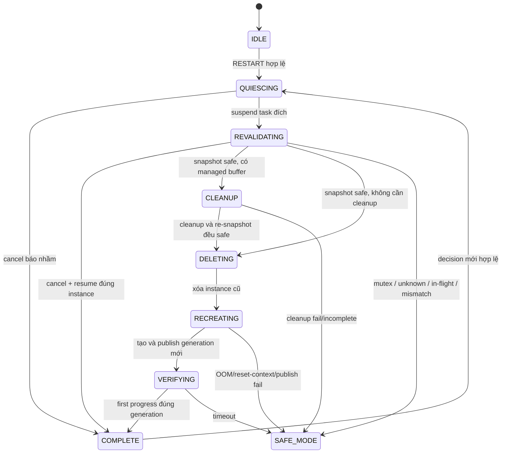

# M4 — Selective Recovery Manager

## 1. Kết quả triển khai

Module 4 hiện có các thành phần:

- `RTSFR/Inc/rtsfr_types.h`: type giao tiếp chung tạm thời;
- `RTSFR/Inc/rtsfr_recovery.h`: API, state, reason, hooks;
- `RTSFR/Src/rtsfr_recovery.c`: state machine phục hồi;
- `RTSFR/Inc/rtsfr_safe_mode.h` và `RTSFR/Src/rtsfr_safe_mode.c`: SAFE_MODE latch và safe-output hook;
- `tests/target/test_m4.c`: target-test độc lập;
- group `RTSFR/Module4` và `RTSFR/Tests` trong project MDK-ARM.

Build đã được kiểm tra với ArmClang 6.24 cho cả firmware thường và cấu hình target-test: `0 Error, 0 Warning`.

## 2. State machine



`SAFE_MODE` là trạng thái latch. Không có API thoát safe-mode trong cùng boot vì tự khôi phục khi chưa có bằng chứng mới là không an toàn.

## 3. Transition và safety gate

| State | Điều kiện bắt buộc | Thành công | Thất bại |
|---|---|---|---|
| QUIESCING | handle/generation còn khớp; target khác supervisor | suspend target | stale trước suspend hoặc SAFE_MODE nếu self-recovery |
| REVALIDATING | callback snapshot tồn tại; snapshot đúng generation | CLEANUP/DELETING | SAFE_MODE khi unknown/unsafe/mismatch |
| CLEANUP | chỉ callback M3 được phép cleanup | re-snapshot không còn buffer và vẫn safe | SAFE_MODE |
| DELETING | handle/generation không đổi | xóa task khác, xóa handle cũ | SAFE_MODE khi invariant đổi |
| RECREATING | generation chưa tràn; reset context sạch; đủ heap | publish handle/generation mới | SAFE_MODE |
| VERIFYING | progress đúng task ID và generation mới | `RECOVERY_OK` | suspend instance không đạt verify rồi SAFE_MODE khi timeout |

Nếu callback `resource_snapshot` chưa được M3 nối, M4 trả unsafe và vào SAFE_MODE. Đây là fail-safe có chủ ý, không phải lỗi giả lập.

## 4. Contract tích hợp

### M2 → M4

M2 gọi:

```c
rtsfr_status_t rtsfr_recovery_request(const rtsfr_decision_t *decision);
```

M4 chỉ nhận `RTSFR_ACT_RESTART`, `RTSFR_ACT_SAFE_MODE` hoặc `RTSFR_ACT_REQUEST_RESET`. Event trùng, generation cũ, recovery đang chạy hoặc safe-mode đã latch đều không tạo recovery thứ hai.

### M3 → M4

M3 nối hai hook:

```c
hooks.resource_snapshot = rtsfr_resource_snapshot;
hooks.resource_cleanup  = rtsfr_resource_cleanup_safe;
```

Snapshot sau quiesce là quyết định cuối. M4 không tin snapshot sơ bộ dùng trước đó trong policy.

### M1 ↔ M4

M1 nối:

```c
hooks.prepare_delete     = registry_prepare_delete;
hooks.publish_generation = registry_publish_generation;
```

Khi progress của instance mới được xác thực bằng caller handle và generation, M1 gọi:

```c
rtsfr_recovery_on_first_progress(task_id, generation);
```

Khi xác nhận false alarm trong cửa sổ trước cleanup/delete, M1 gọi:

```c
rtsfr_recovery_cancel_pending(event_id, task_id, generation);
```

### M4 → M2/M5

- `record_result`: cập nhật retry history/statistics;
- `trace`: đưa event nhỏ vào ring buffer, không UART blocking;
- `request_reset`: yêu cầu lớp watchdog/reset của M5;
- `apply_safe_output`: đặt GPIO/output demo về trạng thái an toàn thật.

## 5. Context rules

- `rtsfr_recovery_process()` chỉ gọi từ supervisor task.
- Không gọi request/process từ ISR.
- Hook snapshot/cleanup/publish không được block lâu hoặc in UART.
- Callback trace/result/safe output được gọi ngoài critical section.
- M4 chỉ giữ critical section ngắn để commit metadata.
- Descriptor argument và dữ liệu context phải sống qua mọi generation.

## 6. Chạy target-test trên board

Trong `Core/Inc/FreeRTOSConfig.h`:

```c
#define configRTSFR_M4_TARGET_TEST   1
#define configRTSFR_M4_TEST_SCENARIO 1
```

Chọn scenario:

| Giá trị | Bài test | Kết quả đúng |
|---:|---|---|
| 1 | clean restart | generation 1 → 2; first progress; PASS |
| 2 | mutex unsafe | không delete/recreate; SAFE_MODE; reason mutex |
| 3 | false-alarm rollback | cancel trước cleanup; task cũ tiếp tục |
| 4 | stale generation | request bị từ chối; task cũ tiếp tục |

Quan sát bằng debugger:

- `g_rtsfr_m4_test_result`: `2` là PASS, `3` là FAIL;
- `g_rtsfr_m4_test_progress_count`: bộ đếm tiến độ;
- `g_rtsfr_m4_test_reason`: reason cuối.

LED PC13 nháy 500 ms khi PASS, 100 ms khi FAIL. Scenario unsafe kéo LED về mức active-low khi safe-mode được latch. Test chạy thay vòng blink bình thường của `bootstrapTask`.

Sau kiểm thử phải trả `configRTSFR_M4_TARGET_TEST` về `0` để build firmware thường.

## 7. Definition of Done của riêng M4

| Hạng mục | Trạng thái |
|---|---|
| Recovery state machine | Hoàn thành |
| Immutable recreate descriptor | Hoàn thành |
| Quiesce rồi revalidate | Hoàn thành |
| Cleanup contract với M3 | Hoàn thành phía M4; chờ M3 cung cấp callback thật |
| Dynamic delete/recreate và OOM | Hoàn thành |
| Anti-double/stale generation | Hoàn thành |
| First-progress verification | Hoàn thành |
| False-alarm rollback trước cleanup | Hoàn thành |
| SAFE_MODE latch/output hook | Hoàn thành; output thật do app/M5 nối |
| Reset request interface | Hoàn thành; M5 nối hành động reset/IWDG |
| Build MDK | PASS, 0 error/0 warning |
| Target runtime evidence | Cần Tú flash và chạy 4 scenario trên board |
| End-to-end M1–M5 | Chờ contract thật từ các thành viên, không thuộc code M4 đơn lẻ |

## 8. Lưu ý khi CubeMX generate lại

Các define và lệnh gọi test nằm trong `USER CODE`, nên CubeMX có thể giữ lại. Tuy nhiên cần kiểm tra lại hai group custom trong `.uvprojx` và include path `../RTSFR/Inc;../tests/target`. Nếu CubeMX xóa chúng, thêm lại source M4/test vào Keil trước khi build.

